# TERRITORY 1.0 — «Тёмная пещера / Царство тёмной энергии»
## Профессиональное техническое задание · Игровой дизайн + UX + интеграция + QA

## ВАЖНО: УТОЧНЕНИЕ ВЛАДЕЛЬЦА 10.11.2026 — CALL OF ODINS И LOOTBORN WARRIORS ИМЕЮТ ОБЩУЮ МЕХАНИКУ

Владелец **лично подтверждает**, что Call of Odins воспроизводит игровую механику Lootborn Warriors, изменив названия и картинки. Поэтому подробные пользовательские видео Call of Odins (сохранённые скриншоты и таймкоды ниже) **не считать сторонним нерелевантным примером**: они являются главным доступным **визуальным эталоном самого игрового процесса и навигации** для реализации Тёмного царства TERRITORY. Просматривать весь путь, а не только отдельные статичные экраны: выбор этажа, бой, награда, тёмная экипировка, 12 слотов и склад, фильтры, сокеты и синтез камней, улучшение, вложенные руны, фонд и возвращение к фарму. Эти механики реализовать работоспособными, а не в виде карточек с надписью «позже».

**Приоритет источников:** (1) прямые видео/кадры владельца Call of Odins как наблюдаемая реализация эквивалентной механики; (2) прямые кадры Lootborn Warriors; (3) публичные гайды с проверкой даты. Разница между названием исходной игры и источником кадра важна для корректного описания доказательств, **но не причина отбрасывать Call of Odins как механический референс**. При расхождениях между версиями сначала сохранять утверждённые решения владельца TERRITORY; при серьёзных несовместимостях выделять конкретный вопрос, а не делать догадки.

**Ограничение доказательств:** утверждение владельца о копировании механики не позволяет достоверно вывести из видео скрытые проценты дропа, точные формулы боя, серверные транзакции или все правила версии 2026. Их разрабатывать и тестировать как собственные правила TERRITORY. **Копировать общие игровые механики можно; чужой код, точные тексты, изображения, музыку, логотипы и узнаваемую графику нельзя.** Нужна законченная собственная реализация TERRITORY, а не оболочка.

**Исполнитель актуального поручения:** Claude Code, а не Codex. Сохранять действующую серверную основу и прогресс игроков; интерфейс и игровое содержание Пещеры Claude вправе полностью переработать в рамках ТЗ.

**НОВЫЕ МАТЕРИАЛЫ (10.11.2026):** 10 дополнительных оригинальных JPEG владельца сохранены в `ChatGPT Library → /TERRITORY/Dark-Cave-References/2026-11-10-screenshots/`. Полный помарочный анализ, сравнительные карточки предметов, 2/7 комплектов, склад, справочник и контекст победных экранов: [накопительный журнал DARK_CAVE_REFERENCE_LOG_20261110_RU.md](DARK_CAVE_REFERENCE_LOG_20261110_RU.md). Claude обязан читать его вместе с этим ТЗ. Не объявлять, что изображения из ChatGPT Library уже доступны в облачной сессии Claude автоматически. Новые материалы владельца добавлять в тот же журнал, не создавать параллельное ТЗ.

**Документ:** TERRITORY_DARK_CAVE_LOOTBORN_PRO_TZ_RU.md  
**Редакция:** 1.0 · 06.11.2026  
**Заказчик / product owner:** владелец TERRITORY 1.0  
**Исполнитель (текущее поручение 10.11.2026):** Claude Code / разработка TERRITORY  
**Основной референс:** Lootborn Warriors — Umbra Realm / Realm of Darkness  
**Репозиторий:** w0980077002-create/territory-game-builde · **Система публикации:** GitHub Pages  
**Задача:** #314  
**Состояние:** ТЗ подготовлено для исполнения первой фазы; игровые числовые параметры последующих фаз требуют проверки и утверждения.

## ФОТОДОКАЗАТЕЛЬСТВА CALL OF ODINS / LOOTBORN — 16 СКРИНШОТОВ С ТАЙМКОДАМИ

**Доказательная база:** настоящие кадры пользовательских MP4 из ChatGPT Library, извлечённые напрямую из видеопотока, без дорисовки механик. Каждому WebP добавлена верхняя строка «имя файла + MM:SS + ID кадра». Исходное разрешение кадра не увеличивалось; нижняя часть экрана может быть обрезана при показе в Markdown — нажимать на изображение для полного просмотра. **Эти скриншоты — исключительно материал внутреннего сравнения/спецификации. Не использовать чужой арт, персонажей, логотипы и интерфейсные фоны в работающей TERRITORY.**

**Надёжность:** видеокадр подтверждает только видимый UI и отображаемые значения аккаунта. Не подтверждает реальные серверные шансы, правильность начисления и наличие API. Для некоторых действий есть кадры *до/после*, поэтому можно подтвердить изменение открытого экрана/фильтра. Числа Lv.500, 105/400 и цены относятся к снятому чужому аккаунту, а не балансу TERRITORY. Владелец отдельно утвердил независимость основной и дополнительной экипировки; это требование не зависимо от чужих цифр.

### ВИДЕО-МАТРИЦА: 14 УНИКАЛЬНЫХ ЗАПИСЕЙ ДЛИННЕЕ 70 СЕКУНД
56 доступных MP4 проверены по метаданным. 17 длиннее 70 секунд, **14 без учёта трёх совпадающих по содержимому копий**. Для 14 уникальных просмотрены выборки кадров из разных частей (не выдавать за полный 100%-ный покадровый просмотр):
| Видео | Длительность | Содержание проверенных кадров | Значение для ТЗ |
|---|---|---|---|
| \`1000080592.mp4\` | 05:15 | Call of Odins: магазин/наборы, почта, фонды, ежедневные награды, благословение, приключения, навыки/вложенные руны, последователь, дополнительная «Тёмная энергия»/склад | **Основной прямой референс тёмного набора и фонда** |
| \`1000074538.mp4\` | 04:05 | Call of Odins: склад, тёмная энергия, драгоценные камни, синтез, вставка, фонды, приключения, выбор навыков и вложенные руны | **Основной прямой референс самоцветов/рун** |
| \`1000086598.mp4\` | 01:42 | Lootborn Warriors: 5×3 Skill / 3 Passive / Skill Rune внутри карточки; улучшения и спутники | **Независимое подтверждение структуры навыков** |
| \`1000081081.mp4\` | 01:37 | внешний бой с боссом, умения, результат/рейтинг | общая боёвка, не доказательство тёмного слота |
| \`1000081077.mp4\` | 01:52 | внешний пример зимнего поля/«Монополии» | не переносить в Пещеру |
| \`1000087890.mp4\` | 01:27 | наша TERRITORY: текущие игровые экраны | визуальное сопоставление, **не Call of Odins** |
| \`1000087181.mp4\` | 01:27 | наша TERRITORY: Поход/Арена | не менять работающий бой |
| \`1000087165.mp4\` | 01:17 | наша TERRITORY: Арена | сохранять рабочую Арену |
| \`1000085661.mp4\` | 02:53 | наша TERRITORY: раунды Арены | подтверждает наличие текущего PvP |
| \`1000085663.mp4\` | 01:46 | наша TERRITORY: бой/Испытания | не путать Пещеру с Испытаниями |
| \`1000085648.mp4\` | 01:22 | наша TERRITORY: игровой бой/Арена | сохранять действующие экраны |
| \`1000086120.mp4\` | 01:12 | наша TERRITORY: «Монополия» | отдельная уже существующая система |
| \`1000086352.mp4\` | 03:33 | экран просмотра YouTube | **не является прямым прохождением референсной игры** |
| \`1000086315.mp4\` | 01:59 | просмотр чата Call of Odin's Chosen | **не доказательство механики, не копировать переписку** |

### A. ДОПОЛНИТЕЛЬНАЯ «ТЁМНАЯ ЭНЕРГИЯ» — ЭКРАН, ПРЕДМЕТЫ, СКЛАД

**A1 — 04:58, \`1000080592.mp4\`.** Персонаж на центральном подиуме, **12 видимых оснащённых позиций** вокруг: оружие/аксессуары/броня, разные цвета рамок и уровни. **Реализация:** независимый экран \`UmbraLoadout\` с 12 допслотами; реальные старые слоты \`mainEquipment\` не затрагиваются. Количество 12 — подтверждённый *визуальный образец*, для TERRITORY включать после одобрения владельцем.
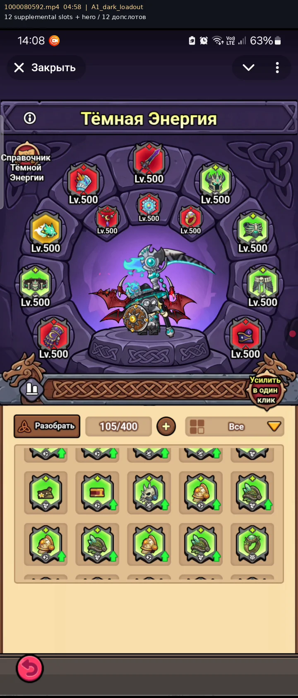

**A2 — 04:59, \`1000080592.mp4\`.** В нижней половине виден отдельный склад \`105/400\`, кнопка расширения, фильтр «Все», сетка предметов и «Разобрать». **Реализация:** собственное окно хранения и инвентаря Umbra, бейдж занято/лимит, проверка выбора предметов и подтверждение разбора; **105/400 — пример, не установленный лимит игры**.
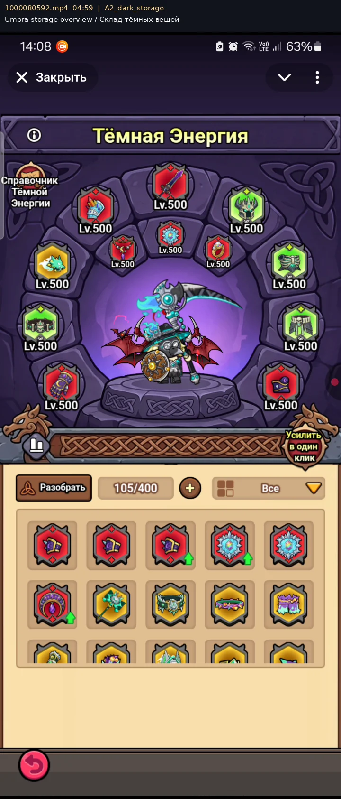

**A3 — 05:04, \`1000080592.mp4\`.** Нажатие на селектор типа раскрывает меню иконок предметов. **Реализация:** фильтр по категориям с 12 отдельными типами только после сверки точных названий/слотов; не спутать с 16 рисунками, где некоторые вообще материалы.
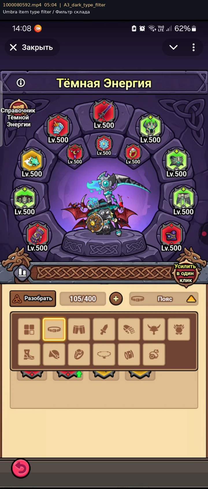

**A4 — 05:07, \`1000080592.mp4\`.** После выбора типа видны **другие, отфильтрованные карточки** иконок; сравнимы изменения сетки A2 → A3 → A4. **Реализация:** фильтр должен действительно менять массив предметов, а не только подсвечивать кнопку. Закрытие меню возвращает к сетке.
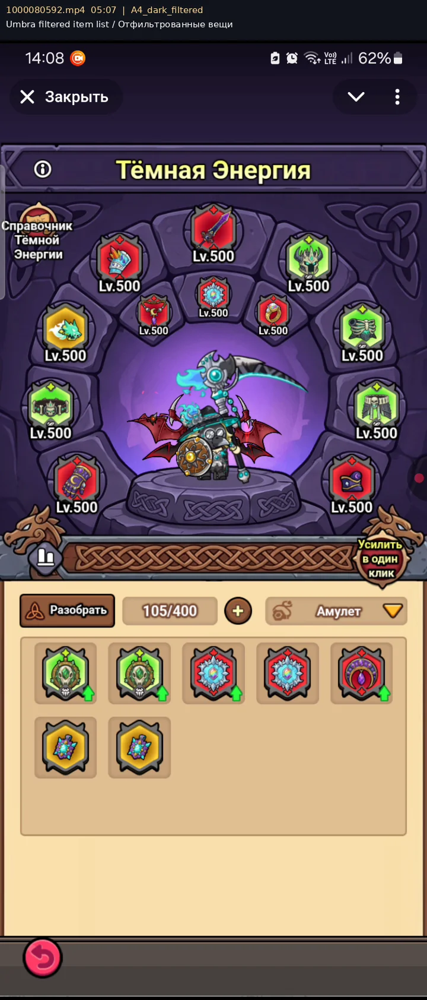

**A5 — действие «Усилить в один клик».** Кнопка видна на A1, но сам процесс/цена/результат **не продемонстрированы**. В P0 сделать кнопку-объяснение без настоящих транзакций. В P1: подтверждение стоимости, список предметов/уровней до и после, право владельца, idempotent receipt, лимиты и обработка переполнения. **Никаких автосливов ценных предметов.**

**A6 — «Разобрать».** Видна слева в A2. Не доказано: какие уровни/редкости можно разбирать, защита надетой вещи, цена, проценты возврата. В P0 preview; в P1 только после отдельных правил; заблокированные/надетые/закреплённые предметы не разбирать.

### B. ДРАГОЦЕННЫЕ КАМНИ — ЭТО НЕ РУНЫ НАВЫКА И НЕ АВТОМАТИЧЕСКИ UMBRA-СОКЕТЫ

**B1 — 01:25, \`1000074538.mp4\`.** Отдельный экран «Драгоценный камень». У выбранной категории (на кадре, например, пояс) **три видимых гнезда** с красными камнями; ниже другие категории с собственными тройками. **Реализация:** отдельный экран Gems, выбор позиции экипировки и гнезда; не выводить из кадра, что каждый предмет в каждой версии обязан иметь 3 сокета.
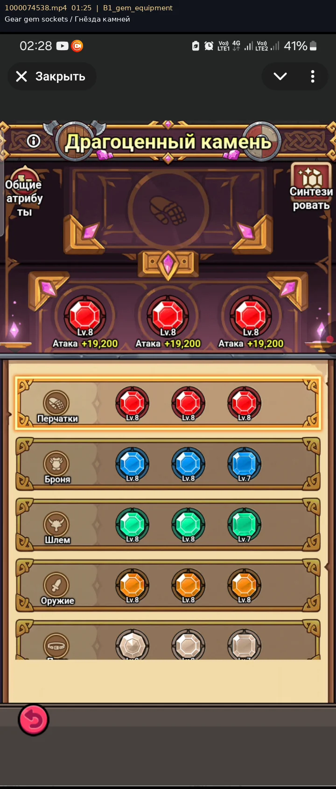

**B2 — 01:26, \`1000074538.mp4\`.** Окно «Синтез драгоценных камней» с палитрой разных форм, цветов и уровней; подпись «**3 камня одного цвета и уровня можно синтезировать для улучшения**», кнопка «Быстрый синтез». Это **прямое экранное подтверждение рецепта 3 одинакового цвета и уровня**, но не гарантированный итоговый уровень или стоимость.
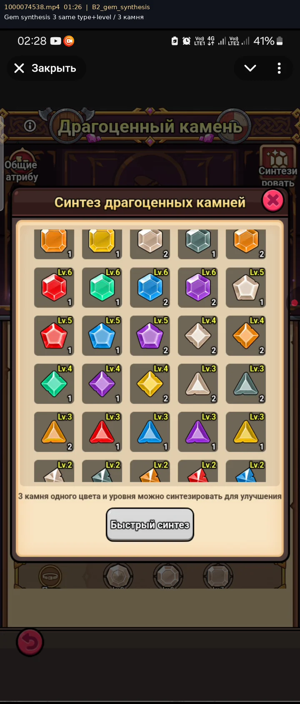

**B3 — 01:31, \`1000074538.mp4\`.** После закрытия окна синтеза видны категории с тремя камнями в строке, выбор другого типа — другие цвета и бонусы. **Реализация:** один выбранный предмет/категория, гнёзда и доступные экземпляры; отмечать, что три видимые ячейки — референс для конкретного показанного экрана.
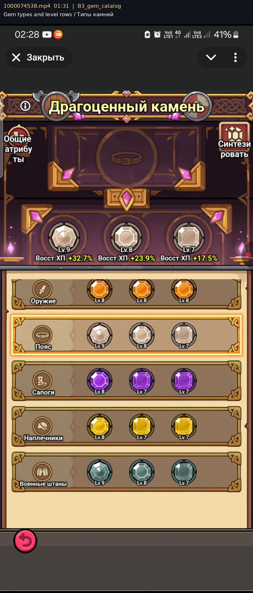

**B4 — 01:33, \`1000074538.mp4\`.** Окно кандидатов на вставку/снятие: название, бонус, доступность, число экземпляров, кнопка действия; выбор камня действительно приводит к модалке. **Реализация:** перед серверной операцией сравнение текущего и выбранного камня, подтверждение судьбы старого, версия экземпляра/сокета, отсутствие расхода в preview.
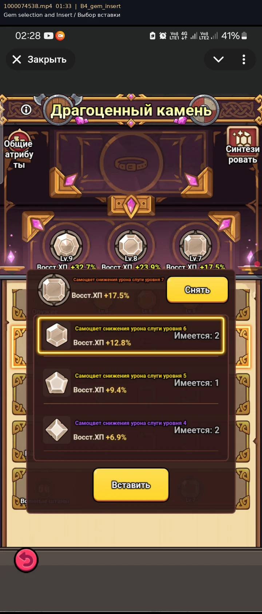

**Критическое уточнение:** на этих кадрах интерфейс драгоценных камней **отдельный** от «Тёмной энергии». В нашем ТЗ ранее самоцветы были автоматически отнесены к тёмной экипировке — **НЕ ДЕЛАТЬ ТАК**. Совместимость общих камней с основным комплектом, Umbra и их источники добычи нужно согласовать отдельно. Для P0 открывать экран в отдельном разделе или информационной вкладке, не переписывать основные предметы.

### C. НАВЫКИ, РУНЫ НАВЫКА, ПАССИВНЫЕ СПОСОБНОСТИ

**C1 — 03:46, \`1000074538.mp4\`.** Пять категорий навыков, по три иконки выбора в каждой (в референсе «База», «Ядро», «Контроль», «Пробуждение», «Финал»), под ними 3 пассивных. **15 вариантов ≠ 15 одновременно экипированных навыков**. В TERRITORY есть ранее утверждённые 15 независимых рунных слотов; **их нельзя молча заменить 5-слотным навыковым билдом**. Два слоя проектировать раздельно и дать владельцу посмотреть на телефоне.
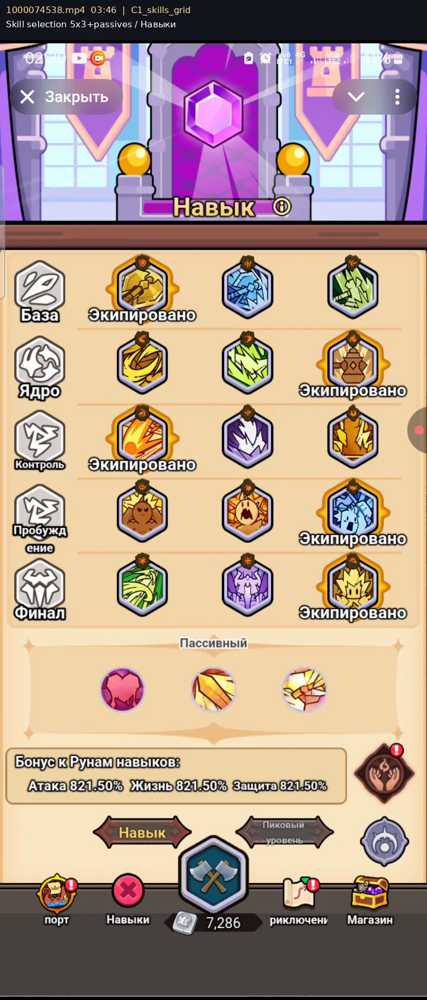

**C2 — 03:50, \`1000074538.mp4\`.** Карточка навыка с описанием, откатом и **тремя вложенными рунами** с персональными уровнями/иконками/эффектами. Нельзя просто реализовать иконку и описание без второй ступени. Не доказано, что из вложенных рун активна только одна; это **не выбирать по догадке**.
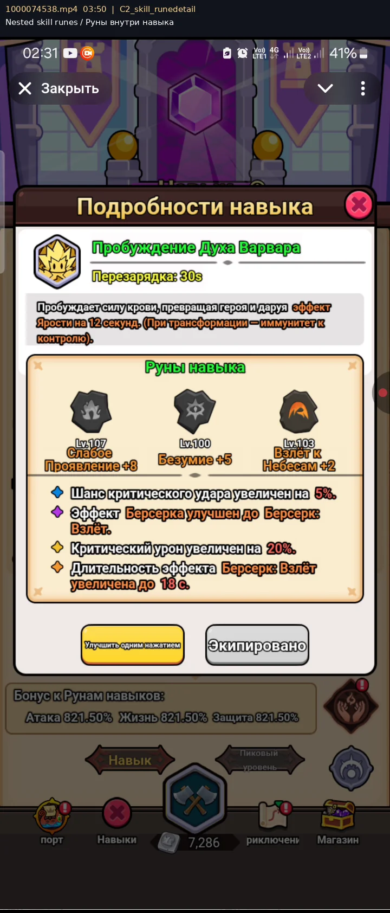

**C3 — 03:34, \`1000080592.mp4\`.** После нажатия на отдельную вложенную руну открывается **третий уровень деталей**: описание, бонусы, «Улучшить» / «Включить» (по референсному кадру). **UX-сценарий:** экран сетки → карточка навыка → карточка руны → возврат без сброса выбора; в TERRITORY P0 без имитации прокачки, P1 с атомарным улучшением.
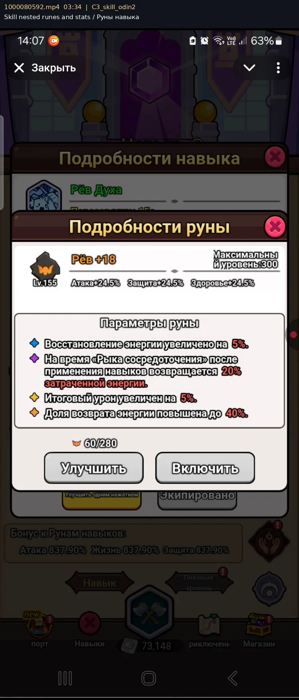

**C4 — 00:44, \`1000086598.mp4\` (сам Lootborn Warriors).** Внешняя сетка \`Skill\`: те же пять категорий по три иконки, 3 Passive, внизу \`Total Rune Bonus\`, вкладка \`Skill\` и отдельная \`Talent\`. Это **независимый видеореференс структуры**, а не доказательство серверной реализации.
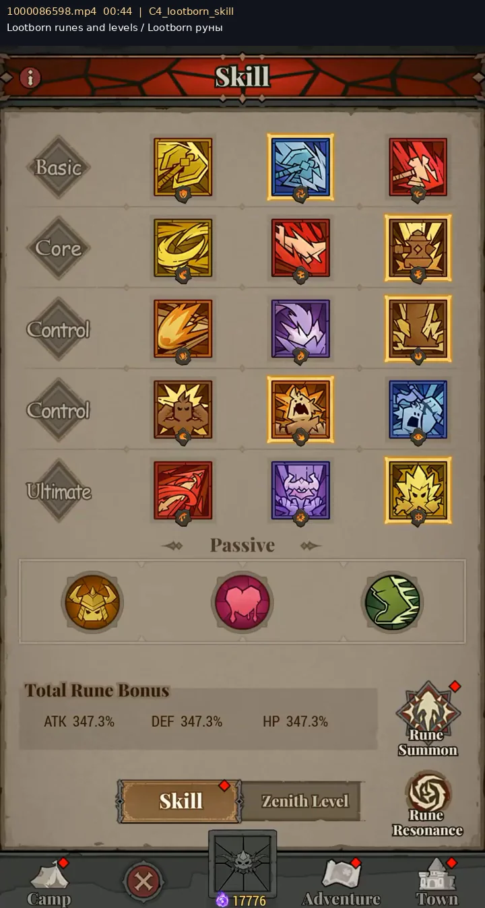

**C5 — 00:50, \`1000086598.mp4\`.** Ещё один кадр той же сетки/выбора. Интерфейс подтверждает различие значков навыков и пассивов; для точного внутреннего окна Skill Rune использовать C2/C3 и подробно проверенные прошлые кадры около 00:42–00:55 записи.
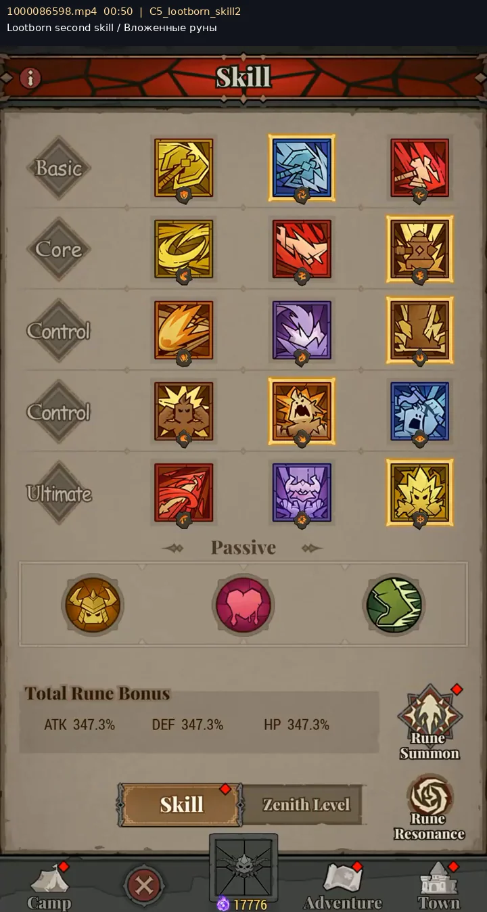

**Разделение ID/хранения обязательно:** \`main_equipment\` (основные вещи) / \`umbra_equipment\` (12 отдельных тёмных позиций) / \`skill_choices\` (5×3 вариантов)/\`skill_rune_modifiers\` (2–3 на конкретную способность) / \`gem_sockets\` (свойства камней). Никакого общего \`slot\` без \`domain\`, никаких автоматических переносов рун 15-slot system.

### D. ФОНДЫ, ГЛУБИНА И ПРИКЛЮЧЕНИЯ

**D1 — 01:32, \`1000080592.mp4\`.** Видеокадр **«Фонд Тёмной Энергии»**: текущий слой подземелья \`240\`, две дорожки (базовая/премиальная), пороги 5/10/15/20/25/30 и т. д.; премиальная помечена «Куплено», видны награды/отметки получения. **Это наглядное доказательство, что Фонд — отдельный экран**, а не сама панель с 12 вещами. Уровень 240 — значение чужого аккаунта, **не повод расширять наш cap 100 без решения владельца**.
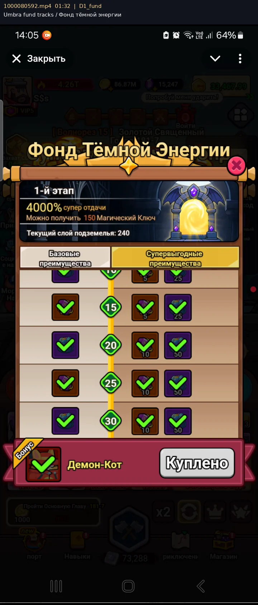

**D2 — 01:30, \`1000080592.mp4\`.** Для сопоставления отдельно виден **«Фонд приключений»** с похожей шкалой. **Не путать фонд приключений, общий фонд уровней и Фонд Тёмной Энергии**; в TERRITORY сделать один понятный собственный фонд Пещеры, не продублировать награды.
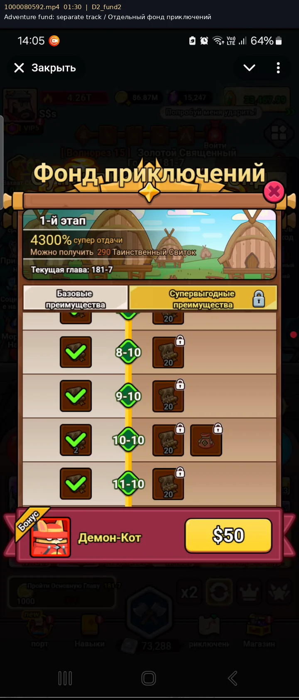

**D3 — 03:18, \`1000074538.mp4\`.** Экран приключений с несколькими отдельными режимами. Видно, что **«Тайное Царство Тёмной Энергии»** — отдельная кнопка/объект карты рядом с боссовыми активностями. **Реализация:** сохранить Тёмную пещеру как самостоятельную точку входа в нашей карте; не смешивать с Походом/Испытаниями.
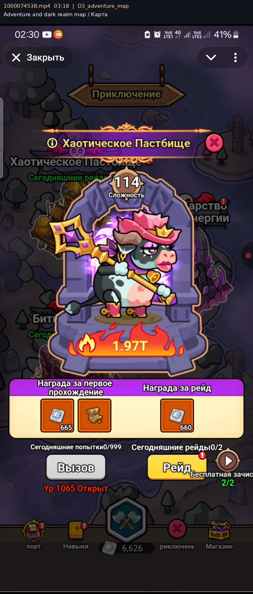

### E. ЧТО ЕЩЁ ЕСТЬ В ОСНОВНОЙ ВИДЕОЗАПИСИ, НО НЕ ТРЕБУЕТ КОПИРОВАНИЯ В ПЕЩЕРУ
| Исходная запись, диапазон | Отдельный экран | Вывод для общего backlog TERRITORY |
|---|---|---|
| 1000080592 00:20–00:50 | магазин, наборы, награды | не создавать второй магазин Пещеры; оригинальный магазин сохраняется |
| 1000080592 00:50–01:00 | почта / посылки | стандартное серверно-подтверждённое получение, уже отдельно существует |
| 1000080592 01:17–01:33 | несколько фондов, в т.ч. тёмной энергии | Пещерный фонд независим от фонда уровней, свободного набора |
| 1000080592 01:38–01:45 | ежедневные и недельные задачи | повторный фарм и фонд должны проверяться отдельно, не выдавать однократную награду повторно |
| 1000080592 02:48–03:02 | автобой / благословение / атрибуты | общий Blessing ≠ доказанная кнопка благословения для каждого боя Пещеры |
| 1000080592 03:09–03:18 | приключения / боссы | не переписывать готовые бои Арены, Похода, Испытаний |
| 1000080592 03:30–03:44 | Skills / Skill Rune / пассивы | второй уровень внутри навыка обязателен в целевой системе |
| 1000080592 04:18–04:52 | «Последователь» и его улучшения | отдельная ветка спутников, не побочный предмет Umbra |
| 1000080592 04:58–05:08 | 12-slot «Тёмная энергия» и склад | приоритетный P0 UI |
| 1000074538 01:25–01:49 | камни / синтез / выбор вставки | отдельный UI Gems, 3→1 правило из прямого кадра |
| 1000074538 03:46–03:54 | навык / вложенные руны | подробная двухуровневая система рун |

**Исполнительное требование к Codex:** до любого реального начисления реализовать только **видимые, проверяемые** 12 допслотов, фильтр, экран предмета, RU/EN, названия/описания и операции-подсказки; ничего не записывать в \`player_inventory.equipped\`; 16 оригинальных арт-файлов TERRITORY остаются в каталоге образцов. Отдельно сделать UI рун и самоцветов, не смешивать. Каждую будущую транзакцию оформлять после личного одобрения владельца и с серверной квитанцией.

**Связанные проверки:** 12 пустых/preview слотов и 16 художественных карточек — это разные количества; 3 сокета — пример **одной выбранной** категории, не универсальное правило каждой вещи; 5×3 — количество **вариантов**, не 15 одновременно активных навыков; две дорожки фонда — бесплатная/премиальная, не двойной дроп. Проверить сцену на 320/360/390/430 px и RU/EN без горизонтального скролла и потери реального «Вызов».

---

### VIDEO-ODINS-20261106: ПРЯМОЙ ВИДЕОАУДИТ CALL OF ODINS / LOOTBORN
**Источник:** именно оригинальные видеозаписи владельца из ChatGPT Library, а не пересказ статей. Повторная проверка 06.11.2026. **Приоритет этого раздела ВЫШЕ устаревших предположений и универсальных схем из гайдов 2025** там, где экран показывает иное. Чужие графические элементы и тексты не копировать, а механику и последовательность действий адаптировать к нашему миру.

#### V1. Объём и границы проверки
- В библиотеке **56 MP4**; через ffprobe проверена длительность **каждого**; **17 файлов длиннее 70 секунд**. SHA-256 выявил: \`1000074538(1).mp4\` = \`1000074538.mp4\` (побайтовая копия); \`1000081077(1).mp4\`, \`1000081077(2).mp4\` = \`1000081077.mp4\`. Итого **14 разных длинных записей**.
- На каждой из 14 разных длинных записей проверены минимум **8 распределённых по длительности кадров**; по двум основным Call of Odins дополнительно просмотрены подробные фрагменты с шагом 3–4 секунды и крупные исходные кадры. **Это скрупулёзная визуальная выборка, не непрерывный просмотр каждой секунды/не доказательство игровых API.**
- **Прямой игровой Call of Odins:** \`1000080592.mp4\` (05:15), \`1000074538.mp4\` (04:05), \`1000081081.mp4\` (01:37, босс/навыки), \`1000081077.mp4\` (01:52, мини-игра «Монополия»). **Lootborn Warriors непосредственно:** \`1000086598.mp4\` (01:42, навыки, их руны и спутники). **Не переносить чужую «Монополию» или внешних боссов внутрь Пещеры**.
- **Собственная TERRITORY для сопоставления:** \`1000087890.mp4\` (01:27, экраны), \`1000087181.mp4\` (01:27, Поход/Арена), \`1000087165.mp4\` (01:17, Арена), \`1000085661.mp4\` (02:53, Арена), \`1000085663.mp4\` (01:46, Арена/Испытания), \`1000085648.mp4\` (01:22, Арена), \`1000086120.mp4\` (01:12, наша «Монополия»).
- **Не подтверждают игровые механики:** \`1000086352.mp4\` (03:33, просмотр стороннего YouTube), \`1000086315.mp4\` (01:59, прокрутка чата Call of Odin's Chosen, не игровой экран). Из скринкастов чужой переписки не выводить никаких статов, цен или прав.

#### V2. ДОПОЛНИТЕЛЬНАЯ ТЁМНАЯ ЭКИПИРОВКА — ПРЯМАЯ ПОДРОБНАЯ СПЕЦИФИКАЦИЯ ПО КАДРАМ
**\`1000080592.mp4\`, примерно 04:55–05:08** — реально открыт экран **«Тёмная Энергия»**, отличный от обычного инвентаря:
1. **Персонаж находится в центре** самостоятельной сцены на подиуме. Вокруг него **12 ВИДИМЫХ ЯЧЕЕК дополнительного снаряжения** (отдельные позиции с предметными иконками, уровнями и цветовыми рамками). Число «12» — проверенное визуально для **этого экрана Call of Odins**, а не доказательство общих правил всех версий Lootborn. Для TERRITORY **принять 12 как целевой визуальный прототип**, пока владелец не изменит число после проверки. Не привязывать эти позиции к существующим основным слотам персонажа.
2. В кадре все заполненные слоты подписаны **Lv.500**. Это **уровень вещей показанного аккаунта**, не стартовый/максимальный уровень тёмного снаряжения TERRITORY и не разрешение выдавать вещи 500 уровня.
3. **Кнопка «Справочник Тёмной Энергии»** слева — отдельный переход к справке/коллекции. Точное содержание открываемого справочника **в этом фрагменте не показано**, не выдумывать.
4. **«Усилить в один клик»** справа — видимая механика массового улучшения; на кадрах **нет подтверждения расчёта стоимости/макс. уровня/что происходит после нажатия**. В TERRITORY показывать пока как preview с разъяснением и заблокированными расходами.
5. **«Разобрать»** в панели склада; **ёмкость \`105/400\`** на аккаунте, кнопка «+», раскрывающийся фильтр, сетка добытых вещей **по пять в ряд** на исходном вертикальном кадре 720 px. \`105/400\` — пример используемой ёмкости, **не согласованная максимальная ёмкость TERRITORY**.
6. В \`1000080592.mp4\` **05:04** реально раскрыто меню **предметных категорий (иконки конкретных типов — пояс/штаны/оружие/перчатки/ботинки/шлем/кольца/аксессуары и др.)**; пример выбранной категории — **«Пояс»**; список вещей отфильтровался. Точный словарь 12 названий всех иконок **не полностью разборчив**, нельзя выдумывать классификатор без открытия карточек.
7. В каталоге видны **разноцветные рамки/редкости**, зеленые стрелочки у некоторых вещей, отдельные значки типа/стихии, различие между экипированным кругом и нижним хранилищем. **Зелёная стрелка, вероятно, сигнал улучшения, но это не доказано нажатием** — подписывать в ТЗ как «индикатор возможной замены/улучшения, назначение уточнить», а не как гарантированно правильный автовыбор.
8. **Две ветки на герое работают параллельно:** основная экипировка остаётся в нынешнем профиле/инвентаре; «Тёмная Энергия» — **второй независимый дополнительный набор**, с собственными двенадцатью позициями и складом. При переключении/снятии тёмного предмета основной экипированный меч/доспех/амулет **не должен измениться**. Никаких вызовов обычной операции equip с предметом umbra.
9. **Переходы для TERRITORY P0:** Пещера → вкладка «Тёмная экипировка» → персонаж на подиуме + 12 отдельных ячеек (пустые/предпросмотр) → тап на слот → список вещей его типа или объяснение «предмет ещё не получен» → предпросмотр карточки и следующего ранга → обратно. Ни одна кнопка не начисляет предмет и не меняет основную экипировку. Ниже компактная сетка 16 созданных иллюстраций; это **образцы**, не собственность героя. На экране нужна явная подпись **«Дополнительный комплект. Основное снаряжение не заменяется»**.
10. **После одобрения:** отдельные \`umbra_item_instances\`, \`umbra_loadout\` ровно с 12 самостоятельными position_id (названия слотов отдельно подтвердить), отдельный \`umbra_inventory\`, редкость/ранг/уровень/эффекты, доступные по этажам; массовое усиление + разобрать с подтверждением, блокировка ценных вещей, фильтры, сравнение, защита от случайного изменения основного снаряжения и двойного списания. Не смешивать со стандартной кузницей без согласования.

#### V3. ДРАГОЦЕННЫЕ КАМНИ — **ОТДЕЛЬНЫЙ РЕЖИМ**, НЕ «РУНЫ НАВЫКОВ»
**\`1000074538.mp4\`, примерно 01:23–01:49**:
- Из общей навигации выбран **«Драгоценный камень»**, **отдельная локация интерфейса**, соседняя с «Тёмной Энергией», а не открытая из внутренней карточки навыка.
- Вверху выбран предмет/вид снаряжения (на кадре символ **пояса**), ниже **3 видимых гнезда**, где уже стоят **три камня** с индивидуальными \`Lv.9 / Lv.8 / Lv.7\` и разными процентами бонуса. Это **три гнезда у показанного выбранного предмета**, не доказательство «по три у абсолютно каждой вещи».
- Ниже вертикальный список **категорий предметов** с **тройками камней** у каждой строки, по разным типам, цветам и уровням. Тап на заполненный камень открывает **«Снять»**; на другой/свободный — выбор камня из имеющихся с показом уровня, бонуса, количества и кнопкой **«Вставить»**.
- Кнопка **«Синтезировать»** открывает окно **«Синтез драгоценных камней»**, в котором написано: **«3 камня одного цвета и уровня можно синтезировать для улучшения»**. Кнопка **«Быстрый синтез»**. Значит, **рецепт 3 одинакового цвета и уровня подтверждён непосредственно экраном Call of Odins**, в отличие от прежнего ТЗ, где рецепт объявлялся совсем неизвестным. **Для видимого прототипа показать 3→1 как референс**; стоимость, коэффициент итогового камня, максимальный уровень и правила потери при извлечении пока не подтверждены.
- **Граница доменов:** видео **НЕ ДОКАЗЫВАЕТ**, что все эти гнёзда принадлежат именно Umbra Gear или что самоцветы выпадают именно из Пещеры. Это отдельный экран драгоценных камней, где в кадре выбран пояс. **Не заставлять разработчика автоматически вставлять камни из «Тёмной пещеры» в дополнительный тёмный комплект.** Утвердить совместимость самоцветов с обычной и дополнительной экипировкой на следующем игровом этапе; в P0 показать отдельные каталоги, не создавать фиктивные связи.

#### V4. НАВЫКИ И «РУНЫ НАВЫКА» — 2-УРОВНЕВАЯ СТРУКТУРА
**\`1000080592.mp4\`, примерно 03:30–03:37 и \`1000074538.mp4\`, примерно 03:45–03:55:**
- Внешний экран **«Навык»**: **5 рядов/категорий** (База, Ядро, Контроль, Пробуждение, Финал); **по 3 варианта в каждом**, выбор одного **«Экипировано» в каждом ряду**. Под сеткой — **3 пассивных** способности и индикатор **«Бонус к Рунам навыков»**.
- **15 видимых вариантов (5×3) — не 15 одновременно экипированных навыков.** Это принципиально; **при этом ранее согласованная для TERRITORY схема 15 независимых слотов не должна молча удаляться или мигрировать**: требование владельца и фактический экран Call of Odins необходимо согласовать на видимом прототипе, отделив «слоты», «варианты» и «рунические модификаторы».
- Тап на выбранный навык **«Рёв Духа»**, кадры \`1000080592.mp4\` ~03:33: описание, длительность/перезарядка (в кадре **15 с**), **2 вложенные руны** со своими уровнями и развёрнутыми бонусами.
- Навык **«Пробуждение Духа Варвара»**, \`1000074538.mp4\` ~03:50: **3 вложенные руны**, показаны **Lv.107, Lv.100, Lv.103** у данного аккаунта; изменения критического шанса, типа эффекта, крита и длительности; текст активного навыка на кадре «Перезарядка 30s». **Числа иллюстративные, не баланс TERRITORY.**
- **\`1000086598.mp4\` (сам Lootborn Warriors), ~00:42–00:55**: Basic Skill \`Bloodlust\` с двумя Skill Rune (пример \`Overwhelm\` / \`Unstoppable\`, разные \`Lv.57/Lv.63\`), отдельные модификаторы haste/stack/resource, кнопка **Upgrade All**, статус **Equipped**; Ultimate Skill \`Ragnarok\` показывает **3 Skill Rune**. Независимый второй референс устройства карточки.
- Что **не доказано** кадрами: в каждой карточке активна ровно одна из 2–3 вложенных рун, или их бонусы работают вместе; порядок расчёта, экономика прокачки, вероятность, лимит уровня, капы. В P0 честный визуальный просмотр; после одобрения серверная проверка loadout snapshot. **Не придумывать выбранность модификаторов и не наделять их «слотами» только из-за разной формы иконок.**
- **Три независимых понятия:** \`skill_choice\` (5 категорий × 3 варианта) / \`skill_rune_modifier\` (2–3 на навык) / \`equipment_gem_socket\` (драгоценные камни). Кроме того, \`umbra_item_slot\` — четвёртый отдельный домен. **Не смешивать ранги, таблицы, ресурсы и API между ними.**

#### V5. ПОЛНАЯ ПРАВКА ТЗ/ПЛАНА ВНЕДРЕНИЯ
**Немедленно в P0, без сервера:**
1. В Пещере добавить/обновить **12-слотовую видимую сцену дополнительного Umbra-комплекта** в оригинальном стиле TERRITORY, отдельный склад/фильтр/карточки/preview улучшения и разбора; 16 настоящих рисунков использовать в галерее без имитации владения.
2. Сохранить обычную «Моя экипировка» как самостоятельный раздел. **Невозможен swap/replace на основной слот** из dark preview.
3. Соседние системы «Драгоценные камни» и «Руны навыков» **не помещать автоматически в Пещеру как один раздел**. Показать в Пещере ссылки-подсказки на развитие героя по отдельным веткам; фактическую навигацию связывать только с существующими разделами.
4. Для UI рун отдельно сравнить текущие 15 слотов TERRITORY с референсом 5×3+3 пассивных и 2–3 рунических модификатора **ВНУТРИ** карточки, без удаления действующих билдов/прогресса; подготовить быстрый прототип и дать владельцу проверить.
5. Интерфейс «Драгоценный камень»: демонстрировать **3 видимых гнезда** для выбранного типа, вставку/снятие и **3 одинаковых камня → синтез** только как **проверенный референс**, реальный инвентарь/списание — после одобрения.

**Фаза серверной интеграции P1/P2 после утверждения владельцем:**
- \`main_equipment\` хранится как сейчас; \`umbra_equipment\` — 12 уникальных допслотов; \`skill_loadout\` / \`skill_runes\` / \`equipment_gems\` не пересекаются. Каждое действие имеет свой валидируемый домен и item instance.
- Тёмное снаряжение и только оно может падать в Пещере как **дополнительная добыча**, не заменяет основную. **Обычные самоцветы — отдельный источник/совместимость обсуждаются**, не утверждать их дроп из Пещеры на основании этих кадров.
- Начало боя снимает серверный снимок героя **с обоими комплектами и рунами**, сервер валидирует источник каждого бонуса и не применяет один сет дважды. На существующую Арену/Поход/Испытания не раскатывать без одобрения баланса.
- Точные лимиты 12 Umbra слотов/3 gem сокета/15 вариантов (5 реально выбранных)/2–3 модификатора подтверждаются только **для показанных референсных экранов**. Нужны отдельные критерии приёмки сохранения/перезагрузки/двух устройств/дублей и запрет изменения главного инвентаря.

**Обязательный чеклист QA**: 12 отдельных видимых слотов; каждый кликабелен, показывает slot type/locked/empty/preview; склад с типовым фильтром и 16 артами; положение предмета после просмотра не меняет основную экипировку; «Разобрать» и «Усилить в один клик» до P1 не активируют транзакцию; описание gem \`3 одного цвета+уровня\`; навыки 5×3, 3 пассивных, вложенные 2–3 руны с уровнями, понятная разница между \`skill rune\` и \`gem\`; RU/EN, 320/360/390/430 px, без лишнего скролла и порчи текущего PvE. Только после теста на телефоне — сервер/статы/выдача.

**Зафиксированные ограничения видео:** Нельзя делать вывод о шансах выпадения, максимальном уровне тёмного предмета, бонусах 12 предметов, цене разбора/массового улучшения, количестве gem-гнёзд **для всех типов**, активном количестве вложенных рун и ценах без фактических экранов с действием. Владелец просил именно «скопировать игровые принципы», не старые предположения.

---

### VIDEO-ATLAS-20261106: ПРЯМЫЕ СКРИНШОТЫ, ТАЙМКОДЫ И ПРОВЕРЯЕМЫЕ ТРЕБОВАНИЯ

**Основание:** записи владельца из ChatGPT Library, а не пересказ чужих гайдов. **15 оригинальных кадров** извлечены из MP4 с помощью FFmpeg, уменьшены до 620 px и сохранены в WebP, без дорисовки. Они находятся в `docs/reference-screenshots/call-of-odins-2026-11-06/` — **не** в публичных игровых ассетах. Скриншоты чужих игр можно использовать как доказательства механики, но нельзя вставлять в живую TERRITORY как готовые UI/арт. Точность таймкодов около 1 секунды. Реальный серверный расчёт, вероятности и расход материалов кадрами без действия не устанавливаются.

**Шесть РАЗНЫХ подсистем:** основная экипировка героя; дополнительная Тёмная энергия/Umbra-набор; драгоценные камни и их гнёзда; выбор основного навыка; вложенные руны навыков; фонд за достигнутую глубину. Они не должны использовать общий слот, общий идентификатор предмета и одну клиентскую операцию `equip`.

#### A. Дополнительная Тёмная энергия: отдельный комплект и склад

**A1 · `1000080592.mp4`, 04:58 (298 с).**

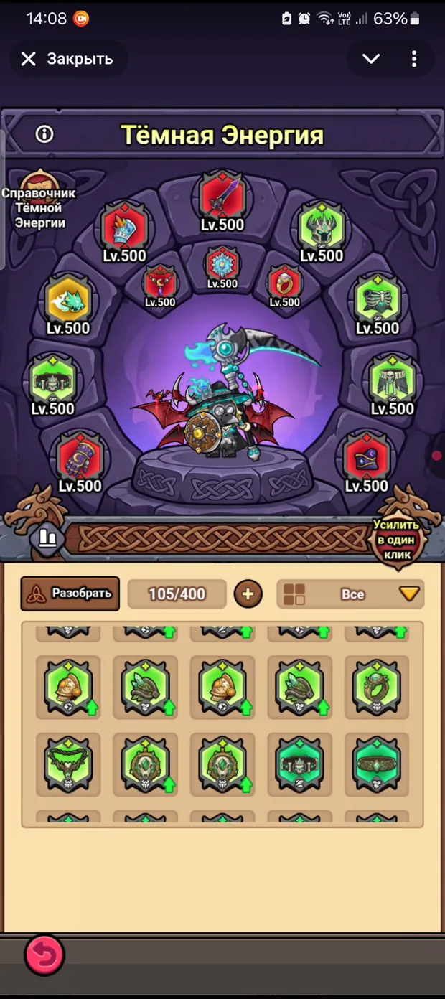

**Наблюдение:** самостоятельный экран «Тёмная Энергия», персонаж на центральном подиуме, **12 визуально различимых иконок экипированной дополнительной экипировки** вокруг него, у надетых вещей `Lv.500` (только для данного аккаунта). Отдельный блок нижнего склада с `105/400`, кнопками «Разобрать», «+», фильтрами и кнопкой «Усилить в один клик» наверху. Слева виден «Справочник Тёмной Энергии». `Lv.500` и `105/400` **не являются согласованными стартовыми цифрами** для TERRITORY.

**ТЗ:** построить в игре настоящий доступный экран **12 дополнительных позиций Umbra**, НЕ 12 обычных слотов. Герой в центре; по нажатию на позицию — тип и состояние пусто/предпросмотр/надето; отдельно показать склад, фильтр, замок, различие рангов и тип вещи. В P0 «Разобрать» и «Усилить в один клик» открывают пояснение без реальных транзакций, а не создают фальшивый успех. Точное назначение каждой позиции выясняется отдельно: число позиций подтверждено, полный именованный словарь всех типов — нет.

**A2 · `1000080592.mp4`, 05:01 (301 с), раскрытый фильтр склада.**

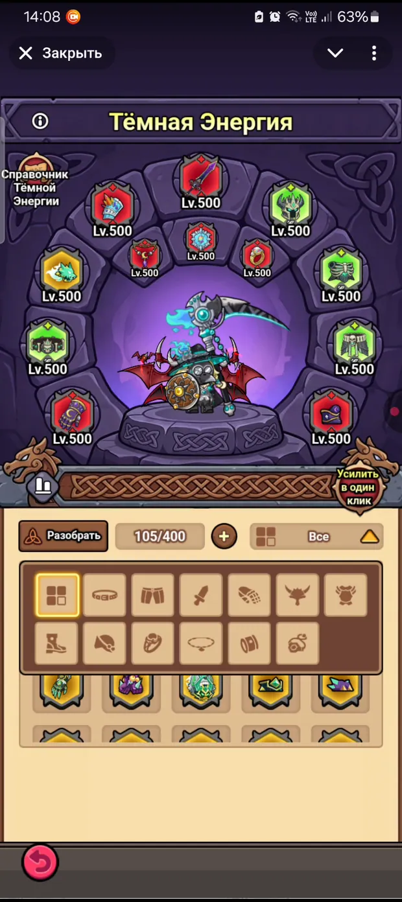

**Наблюдение:** в фильтре плитки с пиктограммами всех вещей и отдельных категорий (пояс, части брони, оружие, аксессуары и другие). На записи не у всех иконок есть читаемая подпись — нельзя автоматически придумывать все названия категорий. **ТЗ:** переключение категории меняет именно содержимое склада; не меняет надетую вещь, активный боевой комплект или основную экипировку.

**A3 · `1000080592.mp4`, 05:07 (307 с), после фильтра.**

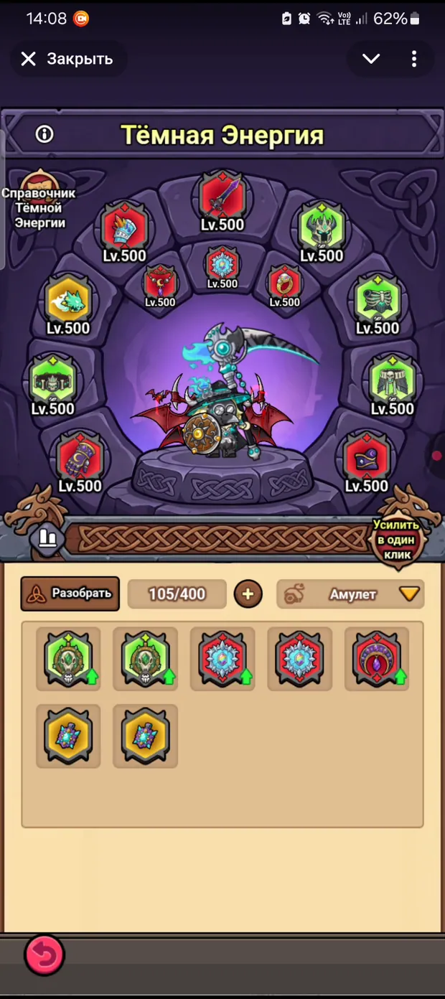

**Наблюдение:** сетка содержит только вещи выбранного типа, видны отличающиеся рамки качества и иконки. Верхний комплект остаётся виден независимо от фильтра. **ТЗ:** отдельные `umbraLoadout` и `umbraInventory`, где фильтр — только видимое состояние. Не подставлять 16 наших рисунков как «полученные» предметы: они являются каталогом образцов до серверной выдачи.

A4 · 05:04 — дополнительный кадр категорий тёмной экипировки

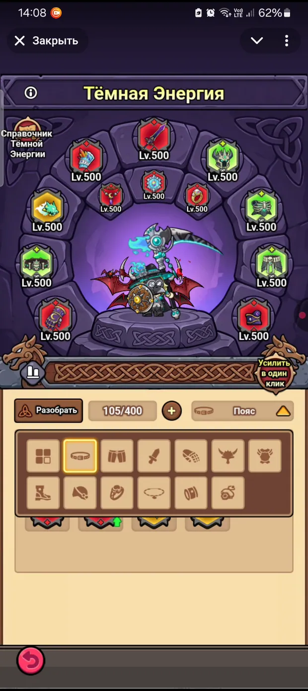

Видны несколько пиктограмм типов предметов и нижняя выборка. Вид экрана — референс поведения, не разрешение копировать чужие изображения или рамки.

#### B. Драгоценные камни — ОТДЕЛЬНО от тёмной экипировки

**B1 · `1000074538.mp4`, 01:24 (84 с).**

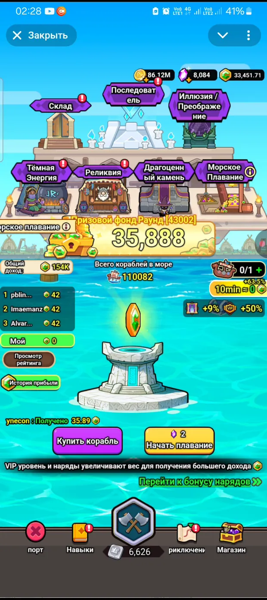

**Наблюдение:** отдельный экран «Драгоценный камень» с выбором предметной категории (на кадре иконка пояса), **три заполненных гнезда** и разными уровнями/процентами в одном выбранном комплекте. Ниже другие категории со своими рядами камней. **Не доказано:** что именно 3 гнезда у всех предметов и что эта система относится только к Umbra. **ТЗ:** экран отдельно от навыков, отдельная сущность `equipmentGemSocket`, на P0 — визуальный пример трёх гнёзд с просмотром бонусов без списаний.

**B2 · `1000074538.mp4`, 01:26 (86 с), окно синтеза.**

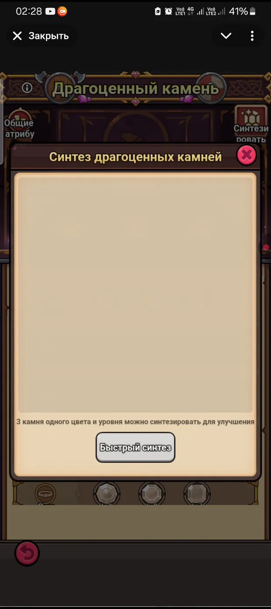

**Наблюдение:** «Синтез драгоценных камней», написано: **3 камня одного цвета и уровня** для улучшения, есть «Быстрый синтез». **Это проверенный скриншотом рецепт референса, а не предположение из гайда.** **Не доказано:** цена, вероятность, максимальный уровень, расход других ресурсов, судьба камня при вынимании. **ТЗ:** показать правило 3 одинакового цвета и уровня в интерактивном обучающем экране; реальные рецепты/расход — позже после одобрения.

**B3 · `1000074538.mp4`, 01:38 (98 с), карточка камня.**

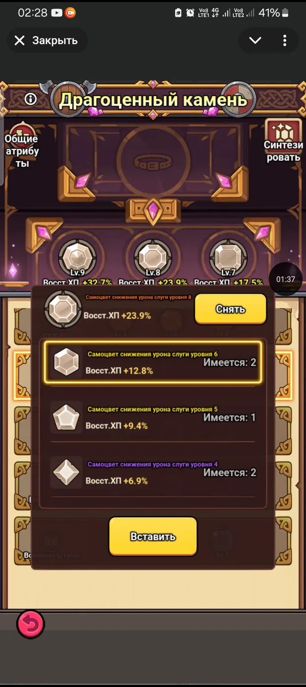

**Наблюдение:** отдельные значения свойства камня, уровни и кнопка действия на его карточке. **ТЗ:** выбирать предмет, затем конкретное гнездо, затем камень с предварительным сравнением характеристик. Никакого объединения `equipment_gems` с вложенными рунами навыков. Отдельно выяснить совместимость этих камней с основной/дополнительной экипировкой; **видеозапись не подтверждает добычу именно этих камней из Тёмной пещеры**.

#### C. Навыки Call of Odins: 5×3, 3 пассивных, вложенные руны

**C1 · `1000080592.mp4`, 03:30 (210 с).**

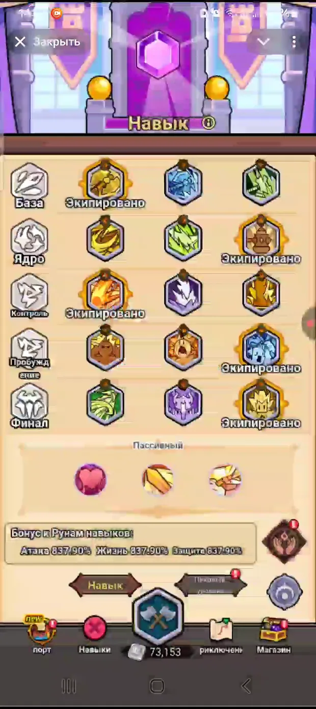

**Наблюдение:** пять категорий **«База», «Ядро», «Контроль», «Пробуждение», «Финал»**, по **3 варианта**, метка «Экипировано» у одного варианта в категории, под ними **3 пассивные** и бонус к рунам навыков. **15 иконок означает 15 предлагаемых вариантов, а не 15 одновременно активных боевых навыков.** У TERRITORY ранее согласованы 15 независимых слотов рун: их прогресс запрещено автоматически удалять, слепо превращая в 5 навыков; сопоставление вынести в отдельный быстрый визуальный прототип.

**C2 · `1000080592.mp4`, 03:33 (213 с), подробности навыка.**

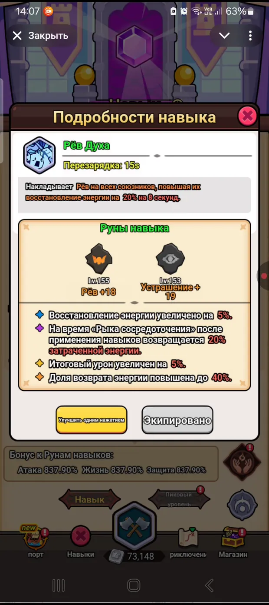

**Наблюдение:** «Рёв Духа», собственные описание и перезарядка; внутри карточки **2 руны навыка** с индивидуальными названиями, уровнями и бонусами. **ТЗ:** открываемый tap навык → карточка с параметрами → 2–3 вложенных модификатора → тап на каждый с детальным эффектом. Отдельное хранение от gem inventory.

**C3 · `1000080592.mp4`, 03:39 (219 с), карточка отдельной руны.**

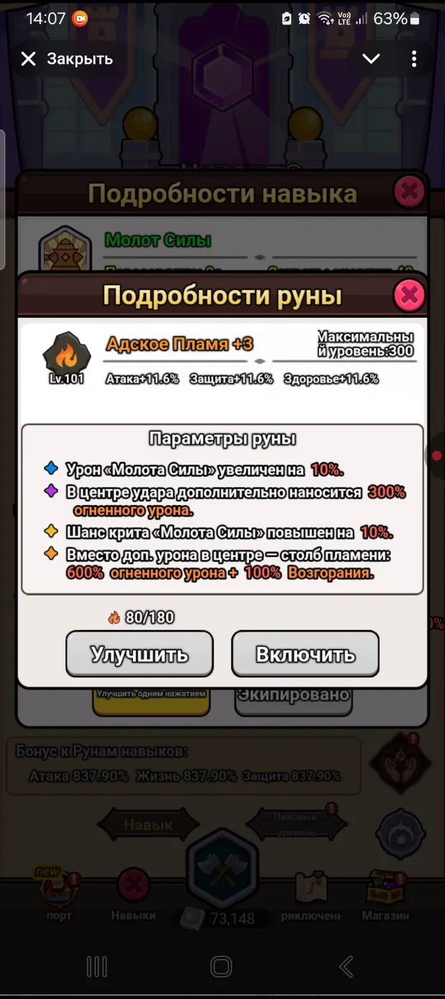

**Наблюдение:** «Подробности руны» с уровнем, подробными свойствами, кнопками «Улучшить» и «Включить». **ТЗ:** вложенные руны — предметная система индивидуального развития, не одна косметическая отметка для всего навыка. Точные суммы, шансы и влияние на PvP неизвестны — не включать в сервер до одобрения.

**C4 · `1000080592.mp4`, 03:42 (222 с), пассивные навыки.**

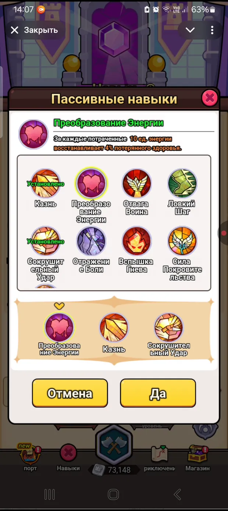

**Наблюдение:** окно выбора из нескольких пассивных умений; нижняя тройка текущих. **ТЗ:** пассивные хранятся отдельно от активных навыков/вложенных рун/самоцветов.

**C5 · `1000074538.mp4`, 03:50 (230 с), иной навык с тремя рунами.**

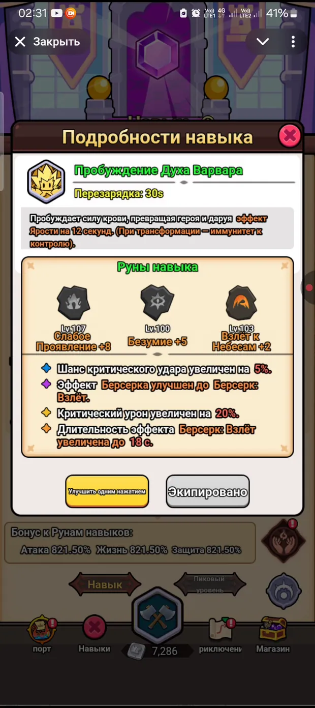

**Наблюдение:** «Пробуждение Духа Варвара» с **3 вложенными рунами**, эффектами/уровнями. **ТЗ:** число вложенных рун варьируется по навыку (в примерах 2 или 3); не объявлять точное количество активных модификаторов доказанным — видеокадр не демонстрирует серверный расчёт.

#### D. Проверка через другую игру: непосредственно Lootborn Warriors

**D1 · `1000086598.mp4`, 00:50 (50 с).**

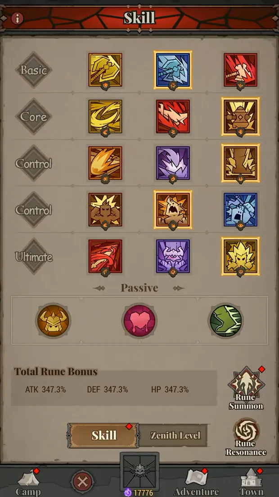

**Наблюдение:** интерфейс Skill, иерархия **5×3**, пассивные умения и общий бонус рун. Отличие языков и ассетов не влияет на существование структуры. **ТЗ:** использовать это как второй источник подтверждения структуры, не переносить чужие картинки/собственные названия.

**D2 · `1000086598.mp4`, 00:54 (54 с).**

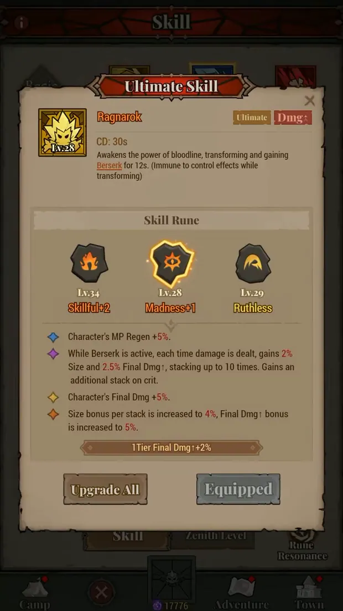

**Наблюдение:** Ultimate Skill и **3 Skill Rune**, индивидуальные уровни, описания, действие `Upgrade All`. **ТЗ:** отдельные уровни и данные модификаторов; массовое улучшение после определения стоимости/сервера. Нельзя приписывать режиму добычи в Тёмной пещере выдачу этих рун без источника.

#### E. Фонд за глубину — третья отдельная система

**E1 · `1000080592.mp4`, 01:32 (92 с).**

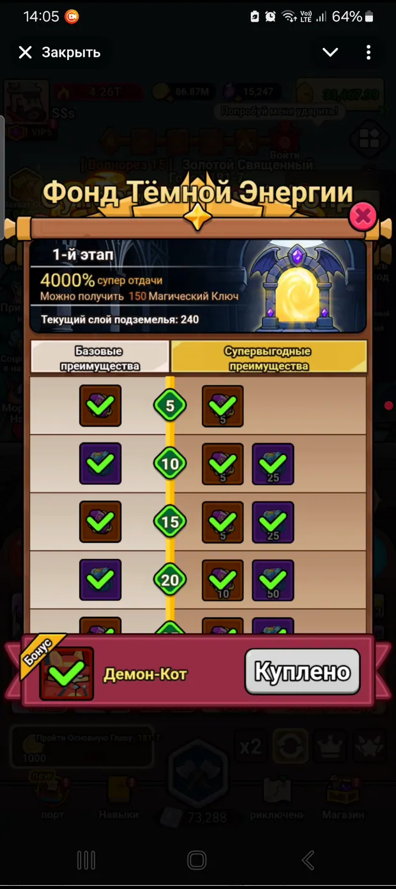

**Наблюдение:** «Фонд Тёмной Энергии», **две дорожки** («Базовые преимущества», «Супервыгодные преимущества»), пороги **5/10/15/20…**, отмеченные получения на конкретном аккаунте. **Это не** экран тёмной экипировки, хотя оба имеют слова «Тёмная Энергия». **ТЗ:** прогресс фонда — максимум впервые достигнутого этажа, а не повторный фарм; бесплатный и премиальный claim — раздельные, однократные. Стоимость/наградные суммы кадра не являются нашими утверждёнными ценами.

#### F. Матрица «показано → что делаем»

| Система | Фактически показано | Для первой тестовой версии TERRITORY | Что нельзя выдумывать |
|---|---|---|---|
| Дополнительная экипировка | Герой, **12 позиций**, склад, типовой фильтр, «Разобрать», «Усилить в один клик» | **12 открываемых отдельных слотов**, preview образцов 16 артов, карточки, фильтрация, без реального предметного начисления | Число слотов основного инвентаря, цену улучшения/разбора, cap уровня, правила бонусов |
| Камни | 3 гнезда у выбранного типа, «Вставить», «Снять», **3 одинаковых цвета+уровня для синтеза** | самостоятельная демо-панель гемов, рецепта и сравнения | что все камни из Пещеры, что все гнёзда по 3, реальную стоимость |
| Навыки | 5 рядов × 3 варианта, 3 пассивных, по 2–3 руны в карточке, улучшение/включение | отдельное окно проверки соответствия уже утверждённым 15 слотам TERRITORY; видимые детальные руны | что 15 иконок = 15 активных навыков; сколько вложенных рун одновременно действует |
| Фонд | отдельный экран, два трека, вехи по глубине | реальный открываемый UI без покупок и выдачи до сервера | цену, поздние вехи и полный набор премиальных наград |
| Бой/Пещера | часть карты и переходы, реальный полный цикл по референсу в кадрах не доказан | сохранить текущие **100 этажей и уже работающий серверный бой TERRITORY**, без подмены квитанции | вероятность тёмного дропа, формулы сложности и число ключей оригинала |

#### G. Все доступные длинные видео: охват и классификация

По 56 доступным MP4 проверена длительность. **17** длятся более 70 секунд, но `1000074538(1)` — побайтовая копия `1000074538`, а `1000081077(1)/(2)` — копии `1000081077`. **14 уникальных длинных записей** проверены по распределённым кадрам; в двух Call of Odins и одном Lootborn дополнительно просмотрены плотные интервалы экранов. Это **не** непрерывный просмотр всех кадров и не доказательство невидимых серверных операций.

| Файл | Длительность | Что именно установлено / ограничение |
|---|---:|---|
| `1000080592.mp4` | 05:15 | **Call of Odins**: тёмный комплект, склад/фильтры, навыки и руны, фонд, задания/VIP |
| `1000074538.mp4` | 04:05 | **Call of Odins**: самоцветы и синтез, навыки и руны, карта/фонд |
| `1000081081.mp4` | 01:37 | **внешний игровой референс** боёв/боссов; не доказательство экономики Тёмной пещеры |
| `1000081077.mp4` | 01:52 | **внешний референс** мини-игры; не добавлять внутрь Пещеры |
| `1000086598.mp4` | 01:42 | **Lootborn Warriors**: Skill, Rune, Passive и дополнительные характеристики |
| `1000087890.mp4` | 01:27 | **TERRITORY**: текущий мобильный интерфейс для сравнения |
| `1000087181.mp4` | 01:27 | **TERRITORY**: мобильные боевые/аренные состояния |
| `1000087165.mp4` | 01:17 | **TERRITORY**: Арена |
| `1000085661.mp4` | 02:53 | **TERRITORY**: боевые раунды и возврат |
| `1000085663.mp4` | 01:46 | **TERRITORY**: Испытания и бой |
| `1000085648.mp4` | 01:22 | **TERRITORY**: Арена |
| `1000086120.mp4` | 01:12 | **TERRITORY**: «Монополия», не Umbra |
| `1000086315.mp4` | 01:59 | **переписка/чат**, не доказательство механики |
| `1000086352.mp4` | 03:33 | **YouTube/видеоплеер**, не прямой клиент Call of Odins |

#### H. Приёмка этого видеоразбора и следующих правок

- Все **15 скриншотов** открываются непосредственно из этого Markdown на GitHub; отсутствуют битые пути. Они **не** лежат в `public/assets` и не попадают в сборку игры.
- Экран Umbra в будущем имеет **12 отдельных дополнительных позиций**, и обычные `equipped`/основные item IDs остаются неизменными при просмотре/надевании тёмных вещей.
- Склады с фильтрами не меняют экипировку; «Разобрать», «Усилить в один клик», «Синтез» не расходуют ресурсы в P0.
- Гемы с показанными тремя гнёздами и рецептом 3 одинаковых помечены как отдельная ветка; нельзя без разрешения автоматически назначать гнёзда основной или дополнительной экипировке.
- Руны навыков описаны как **вложенные модификаторы** выбранных навыков с индивидуальными уровнями, отдельно от пассивных и от слотов камней; текущую утверждённую 15-слотовую систему TERRITORY **не стирать**.
- После видимого внедрения на телефоне владелец утверждает слоты, числа, экономику и влияние на все PvE/PvP бои; лишь затем — серверная интеграция с квитанциями и сохранением старого инвентаря.

---
### 0. Решение и границы

ЗАДАЧА: достроить существующую игровую Тёмную пещеру TERRITORY по функциональной модели Umbra Realm из Lootborn Warriors: прохождение этажей → борьба за новые классы тёмного снаряжения → самоцветы и комплекты → подбор полезных свойств → перековка → дальнейшее продвижение или повторный фарм. Не создавать другой авторский режим и не переписывать существующую Пещеру с нуля.

РАЗРЕШЕНО ЗАИМСТВОВАТЬ: общие принципы механик, логику интерфейсных сценариев, структуру прогрессии, назначение предметов и последовательность пользовательских действий.

ЗАПРЕЩЕНО КОПИРОВАТЬ: чужие готовые изображения, анимации, интерфейсные композиции до степени смешения, персонажей, исходный код, музыку, фирменные тексты и названия. У TERRITORY — собственные герои-викинги, старый дуб, ковка, верёвки, золото, собственные 16 иллюстраций.

**ОСНОВНОЙ РАБОЧИЙ ПОРЯДОК ВЛАДЕЛЬЦА:**
1. Сначала законченная **видимая версия в самой игре** со всеми 16 артами, действующими вкладками/карточками/подсказками, не ломая текущие реальные бои и награды.
2. Владелец играет на телефоне, сообщает замечания; исполнитель устраняет их и показывает обновлённый результат.
3. Только после одобрения — изменение server API, реальная добыча, экземплярный инвентарь, синтез, перековка, баланс, фонд и платежи.

**НЕ ДОПУСКАТЬ:** фиктивного получения вещи, вымышленных ставок выпадения и действий «успех», которые ничего не делают; потери данных игроков/инвентаря/VIP/камней; переноса незавершённого режима в официальный релиз без подтверждения.

### 1. Источники истины и достоверность

| Код | Источник | Что подтверждает | Ограничение |
|---|---|---|---|
| T1 | Текущий main, ServerAdventureScreen.tsx | 100 этажей, состояние камней, серверный start/advance/resume, реальные монеты/XP, список этажей | это состояние TERRITORY, а не Lootborn |
| T2 | caveLootPreview.ts | пока **предпросмотр** тёмного снаряжения (1), самоцветов (6), комплектов (41) | не действующая loot table |
| T3 | scripts/check-dark-stones.mjs | 5 первых камней, +3/UTC-день, дебет 1, проверка изоляции кошелька | тест staged-контракта; не доказывает актуальный production сам по себе |
| T4 | staged/territory_cave_stone_refund_on_defeat_20261106.sql | схема возврата камня после терминального поражения или ничьей без повторного возврата | наличие staged SQL не гарантирует активацию в production |
| L1 | Treyex Beginner Guide Wiki (13.08.2025) | Magic Keys, сохранение ключа при поражении, самоцветы с 6, комплекты с 41 | вторичный гайд 2025, проверить в текущем клиенте |
| L2 | Treyex Sidekicks/Umbra Gear (13.08.2025) | ранги Umbra 1/11/21/31/41/61/81/121/161, Umbra Essence и переопределение статов | вторичный гайд 2025, не live-конфигурация |
| L3 | Treyex Build Guide | полезность аффиксов, примеры полного 6/6 и отдельных 3-piece синергий | наборы различаются, не значит «2/4/6» у всех |
| L4 | LDPlayer Beginner Guide | башня Umbra Realm и требование специальных ключей | обзор, не точные формулы |
| V | видеоссылки GodCrow + Фазоран | релевантные примеры первого предмета/сета/фарма | ролики найдены, **полный покадровый разбор не подтверждён**, не считать кадры и таймкоды проверенными |

**УРОВНИ ДОКАЗАТЕЛЬСТВ:** «реализовано в TERRITORY» = установлен код; «референс Lootborn 2025» = подтверждается внешним описанием; «решение для TERRITORY» = правило этого ТЗ; «не определено» = запрещено включать в живой баланс до проверки. Ни одно «не определено» не блокирует первый визуальный результат.

### 2. Продуктовая модель — пользователь должен понимать зачем возвращаться

**Ключевая петля:** войти → увидеть следующий этаж и следующий ранг → бросить вызов → получить подтверждённую победу → открыть глубину / (позже) найти тёмную вещь или материал → сравнить силу и эффекты → улучшить сборку самоцветом/набором/перековкой → попытаться глубже → в будущем повторно фармить пройденные этажи для лучшей комбинации.

**Обязательные элементы интереса:**
- игрок видит ближайшую ступень добычи (например, на этаже 5 подсказка «Самоцветы с 6», на 40 — «Комплекты с 41»);
- каждая категория имеет понятное назначение, а вещи с лучшим набором эффектов могут быть ценнее вещи с более высоким «сырым» рангом;
- режим не требует VIP/покупки, бесплатные этажи доступны всем;
- после поражения игра объясняет, что улучшать, и не присваивает победу;
- нынешний герой, спутники и экипировка остаются узнаваемыми — не новая игра внутри игры.

### 3. Существующее TERRITORY — сохранить без регрессий

1. Локация с карты города. Отдельная от «Похода» и «Испытаний».
2. «Царство тёмной энергии», существующие **100 этажей**, статус пройденного/текущего/закрытого, боссы — **из существующего** игрового набора, без придуманных новых боссов.
3. Тёмный камень: старт **5**, пополнение **+3 за каждый прошедший UTC-день**, стоимость одного нового входа **1**. Изменение камней/прогресса — только по настоящему ответу сервера.
4. Настоящий старт, развитие боя, квитанция, восстановление после перезагрузки Telegram, авторизованный результат; за подтверждённую победу — существующие монеты и XP.
5. При поражении/ничьей нет награды/нового этажа; показать возврат камня **только если** сервер вернул флаг dark_stone_refunded. Сверить production отдельно.
6. Текущая кнопка вызова работает **только для непройденного открытого этажа**. Повторное прохождение старых этажей в текущем серверном API не подтверждено; разблокировку farm/repeat выполняем после продуктового одобрения, **не снимаем одну проверку в UI без server-контракта**.
7. Пояс/эликсиры в Пещере, если их эффекты ещё отключены, нельзя выдавать за работающие; боевой движок, Арена, 15 слотов рун, VIP и существующее состояние игрока — не объект первой фазы.
8. Не заменять нынешнюю награду новым клиентским «дропом», не делать fake «Получено».

### ОБЯЗАТЕЛЬНЫЙ КОНТРАКТ: ДВА НЕЗАВИСИМЫХ НАБОРА ЭКИПИРОВКИ

**Решение владельца 06.11.2026 — НЕ ОБСУЖДАЕТСЯ:** в TERRITORY должна существовать **основная экипировка героя** И **дополнительная тёмная экипировка (Umbra)**. Это **две параллельные системы**, а не две разновидности предметов одного обычного слота. В Пещере выпадает исключительно дополнительная тёмная экипировка, а не обычные предметы для замены основного снаряжения.

**Что показываем в игре:**
1. **Основной комплект** — нынешние обычные слоты, герой, инвентарь, кузница, улучшения и старые предметы. Никаких изменений.
2. **Дополнительный тёмный комплект** — **своя отдельная панель слотов, свой список экземпляров и отдельные правила комплектов/самоцветов/перековки**. Весь герой одновременно сохраняет основной комплект и носит активный дополнительный тёмный комплект.
3. «Экипировать тёмную вещь» может заменить **только тёмную вещь того же дополнительного слота**, но **никогда** основной меч/кольцо/шлем/доспех. «Снять тёмную вещь» тоже не снимает основную.
4. Тёмные свойства и бонусы, после будущего серверного одобрения, **добавляются к разрешённой силе основного героя и других эффектов** по отдельным, балансным правилам; удвоение статов и неучтённые PvP бонусы запрещены. Точные формулы ещё требуют решения владельца.
5. Для UI нужен отдельный экран **«Дополнительное тёмное снаряжение»** с чётким разделением: «Обычная экипировка: без изменений» / «Тёмная экипировка: отдельный набор». В первой тестовой фазе — понятный **просмотр будущих тёмных слотов без фиктивной выдачи**. Вкладка «Добыча» показывает тёмные предметы именно для этого набора. При осмотре обычного основного инвентаря их не следует обозначать как обычную броню, заменяющую существующую.
6. **Тёмные самоцветы**, синтез, тёмная эссенция и сетовые бонусы принадлежат отдельной системе. Применение тёмных самоцветов к обычной основной экипировке **не разрешено и не предполагается**.
7. **Независимое хранение / технические ограничения фазы P1:** `equipment_domain='umbra'`, `umbra_slot_key`, `owner_id`, `instance_id`, `item_version`; отдельный `umbra_loadout` и `umbra_inventory` (схему согласовать с существующей БД). Клиентские операции add/equip/unequip/replace/reforge должны проверять домен и отвергать обычные item IDs. **Никаких изменений в `public.player_inventory.equipped` или основных слотах при экипировке Umbra**.
8. Число и точные названия **именно дополнительных** слотов ещё проверяются по видео Lootborn (гайды показывают, в частности, Weapon, Bracer, Necklace, Ring и пример набора 6/6). Схема «6/6» из гида — не разрешение предположить универсальный точный экран слотов и не аргумент использовать основные слоты. В нашем прототипе сначала явно отделённая система, количество слотов — визуальный пример до проверки.
9. **Приёмка:** надеть тёмный предмет → основные вещи/их ID/редкости/заточки остались неизменными; тёмный предмет попал в отдельный активный слот; сработали только одобренные дополнительные эффекты; снятие/перековка/ошибка/два устройства не затронули обычное снаряжение; ни один тёмный item ID не отправляется в API обычной экипировки.
10. Если текущий графический пример 16 рисунков ошибочно называет их «обычной экипировкой», исправить подписи. 16 художественных файлов — **каталог образцов** для отдельного Umbra-набора, НЕ разрешение выдавать их в основные слоты. Важные категории: тёмная дополнительная экипировка (оружие, броня, аксессуар, примеры комплектов), самоцветы, эссенция, материалы.

**Основание:** решение владельца и игровая референсная ветка Umbra Gear (Treyex Sidekicks Guide и Builds; обычная экипировка описана отдельно в BlueStacks Progression Guide). Не выдавать количество дополнительных слотов за проверенный факт современной версии без кадров.

### 4. Ступени прогрессии / механическая спецификация

**Референсная шкала Lootborn** (для первого UI фиксируется как дизайнерская шкала; последующий баланс/реальная выдача — отдельное утверждение):

| Этаж | Категория | Как показывать игроку | Фаза реальной добычи |
|---:|---|---|---|
| 1 | Common Dark Gear | стартовая ступень тёмного снаряжения | после серверной интеграции |
| 6 | Socket Gems | отдельное открытие самоцветов, **не ранг брони** | после серверной интеграции |
| 11 | Fine | следующий ранг тёмных предметов | после утверждения баланса |
| 21 | Rare | следующий ранг | после утверждения баланса |
| 31 | Fabled | следующий ранг | после утверждения баланса |
| 41 | Set | комплектные предметы, наборы и бонусы | после утверждения баланса |
| 61 | Ancient Fabled | древние особые вещи | после утверждения баланса |
| 81 | Ancient Set | древние комплектные вещи | после утверждения баланса |
| 121 | Primal Fabled | будущая прогрессия — **не доступно в 100 этажах** | **не внедрять** |
| 161 | Primal Set | будущая прогрессия — **не доступно в 100 этажах** | **не внедрять** |

**Инварианты:** «достигнут этаж» ≠ «получен конкретный предмет»; «открыт ранг» ≠ «гарантированный дроп»; «показан рисунок» ≠ «у игрока есть вещь». Не генерировать клиентские шансы. На странице предмета указывать доступность по реальному maxClearedFloor и точную подпись «Предпросмотр — предмет пока не выпадает».

### 5. Экраны и UX: контракты уровня «что нажали → что произошло»

#### UI-01. Карта → Пещера
- Нажатие на существующую кнопку «Тёмная пещера» открывает текущий ServerAdventureScreen, а не вторую сцену.
- Загрузка: показывать статус, не обнулять визуально уровень/камни до ответа RPC.
- Ошибка/нет сети: «Повторить» / «Восстановить бой», без нового списания.
- Восстановление предыдущего незавершённого server session важнее создания нового «Вызова».

#### UI-02. Основной экран «Царство тёмной энергии»
- **Шапка:** название, иконка Тёмного камня + настоящий баланс, текущая глубина N/100, компактная кнопка информации, кнопка «Благословение» (информационная/preview до подключения).
- **Портал:** существующая пещерная сцена с оригинальными фиолетовыми/синими магическими акцентами.
- **Навигация:** четыре компактные вкладки «Этажи» / «Добыча» / «Усиление» / «Фонд»; в «Усилении» подэкраны «Самоцветы», «Перековка», «Комплекты». Верхний ряд не должен занимать весь телефон.
- **Этажи:** независимый вертикальный scroll, одновременно **минимум три читаемых этажа**, предпочтительно 5–6, «Мой этаж» возвращает к актуальному. Статусы и реальные боссы визуально различимы.
- **Закреплённое действие:** «Вызов · 1 Тёмный камень» видно без прокрутки всей страницы. Отключено с причиной, если 0 камней, выбран не текущий этаж, сервер занят, ожидается результат, пройдены все 100 или progress неизвестен.
- **Тап текущего:** детали реального врага/этажа и подтверждённого вознаграждения; **добыча новых предметов указана как будущая**.
- **Тап пройденного:** обзор и отметка «Пройден», будущий фарм только как пояснение; **никакого фиктивного стартового действия**.
- **Тап закрытого:** причина «Сначала пройди предыдущий», нельзя открыть через подмену индекса.

#### UI-03. Реальный бой
- Кнопка «Вызов» вызывает существующий server start не более одного раза (double tap и navigation race blocked). Затем нынешняя сцена боя со своими живыми героями и врагами, HP, умениями и реальными server events.
- **Победа:** только receipt → +gold/+XP, продвижение, кнопка «К этажам». До server loot никакого изображения нового тёмного предмета с заголовком «Получено».
- **Поражение/ничья:** нет loot/XP/глубины; камень отображается возвращённым только по факту server receipt; «Восстановить бой», «К этажам».
- Эффекты эликсиров и рун не добавлять без утверждённого авторитетного snapshot.

#### UI-04. «Добыча» — подключить все 16 рисунков в первой фазе
- Сетка полноценных карточек с нашими WebP: разные уникальные рисунки, имя RU/EN, тип, ранг и состояние (пример/требуется глубина).
- **Рабочие фильтры:** «Все», «Снаряжение», «Самоцветы», «Материалы»; по нажатию число карточек пересчитывается, пустой фильтр не имитируется.
- Нажатие на любую карточку → полноценное окно с оригинальным арт-изображением, текстом RU/EN, описанием назначения, условием открытия, пояснением принадлежности к будущей системе.
- Закрытие X/Back/доступный жест возвращает к прежней вкладке и позиции списка. При ошибке картинки — понятный fallback с именем, не белый прямоугольник.
- **Нет** активных «Надеть», «Продать», «Разобрать», «Забрать», пока отсутствует настоящий предмет на сервере.

#### UI-05. «Усиление»
- **Самоцветы:** три существующих рисунка, просмотр гнезда и назначения, пример слияния; до 6-го этажа подсказка про порог. Число гнёзд и рецепт синтеза неизвестны → не придумывать реальное число и не тратить вещи.
- **Перековка:** выбрать демонстрационную тёмную вещь, показать условную основную характеристику + условные дополнительные свойства с яркой меткой «ПРИМЕР»; выбрать 1–2 строки, показать иллюстрацию эссенции и объяснение reroll. **Не списывать эссенцию; не крутить реальный рандом; не отображать ложный «успех»**. Цифра «2» из гида может означать рекомендацию, а не лимит версии 2026.
- **Комплекты:** подэкран открывается для ознакомления всегда, активность от 41-го этажа. Показать, какие части и особые эффекты возможны; рисунок 12 можно использовать в качестве демонстрационного набора. Схема 6/6 — пример известного гайда, **НЕ разрешение использовать основные слоты героя**: тёмный комплект всегда отдельный; точное число дополнительных слотов требует проверки. Не добавлять боевых бонусов в первой фазе.
- **Благословение:** открывает честное окно с будущей функцией без бонусов. Не путать общее Blessing Tree Lootborn с локальным благословением в нашей Пещере.

#### UI-06. «Фонд тёмной энергии»
- Дорожка «Бесплатно» и дорожка «Премиум», закреплённые по **максимальному впервые достигнутому этажу**; пример вех 5/10/15/20/25/30/35; не выдавать награды «на повторе».
- Состояния «будет доступно», «порог достигнут (предпросмотр)», «пока не выдаётся». Нет активной покупки, премиальной разблокировки, реального «Забрать», Stars/USDT или красных алмазов до решения владельца.
- Показать в интерфейсе смысл бесплатной/премиальной дороги, но НЕ выдавать иллюстративные награды за реальные права.

### 6. 16 утверждённых игровых ассетов — стабильный реестр

**Источник в main** (коммит 588b127): public/assets/territory/cave-loot/2026-11-06/ . Корректный runtime URL: import.meta.env.BASE_URL + "assets/territory/cave-loot/2026-11-06/" + filename .

| Item ID | WebP файл | Имя RU / EN | Категория |
|---|---|---|---|
| shadow_amulet | 01-shadow-amulet.webp | Тёмный амулет / Shadow Amulet | Снаряжение, аксессуар |
| void_axe | 02-void-axe.webp | Топор Бездны / Void Axe | Снаряжение, оружие |
| rune_boots | 03-rune-boots.webp | Рунные сапоги / Rune Boots | Снаряжение, ботинки |
| azure_crystal | 04-azure-crystal.webp | Лазурный кристалл / Azure Crystal | Самоцвет |
| storm_crystal | 05-storm-crystal.webp | Грозовой кристалл / Storm Crystal | Самоцвет |
| void_spear | 06-void-spear.webp | Копьё Бездны / Void Spear | Снаряжение, оружие |
| shadow_gauntlets | 07-shadow-gauntlets.webp | Теневые перчатки / Shadow Gauntlets | Снаряжение, перчатки |
| ruby_crystal | 08-ruby-crystal.webp | Рубиновый кристалл / Ruby Crystal | Самоцвет |
| shadow_ring | 09-shadow-ring.webp | Кольцо Тени / Shadow Ring | Снаряжение, аксессуар |
| ward_shield | 10-ward-shield.webp | Щит защиты / Ward Shield | Снаряжение, условный слот |
| shadow_mail | 11-shadow-mail.webp | Тёмная кольчуга / Shadow Mail | Снаряжение, нагрудник |
| royal_shadow_mail | 12-royal-shadow-mail.webp | Королевская тёмная кольчуга / Royal Shadow Mail | Снаряжение, образец сета |
| shadow_greaves | 13-shadow-greaves.webp | Теневые поножи / Shadow Greaves | Снаряжение, поножи |
| umbra_essence | 14-essence-flask.webp | Тёмная эссенция / Umbra Essence | Материал перековки |
| rune_emblem | 15-rune-emblem.webp | Рунная эмблема / Rune Emblem | Потенциальный материал, НЕ новый слот рун |
| horned_helmet | 16-horned-helmet.webp | Рогатый шлем / Horned Helmet | Снаряжение, шлем |

Все названия — рабочая локализация TERRITORY, не названия оригинальных вещей Lootborn. Рисунок щита НЕ авторизует новый боевой слот автоматически. Не использовать emoji вместо WebP, не подменять оригинальные 16 изображений стоками и чужими ассетами.

**Техническое использование:** единый типизированный read-only каталог, постоянные Item ID, относительный к BASE_URL URL; object-fit: contain, lazy loading миниатюр, доступный alt, aria-label и текстовый fallback. Для мобильного нельзя скачивать полноразмерные PNG: использовать подготовленные WebP, суммарно около 1,2 МБ. Проверить HTTP 200 и MIME image/webp по URL опубликованной игры.

### 7. Данные, модель и контракты реализации

#### P0 — только frontend-каталог и существующий бой
Предлагаемый контракт CavePreviewItem:
- id, filename, name_ru, name_en, description_ru, description_en, category, suggestedUnlockFloor, tierLabel, previewOnly=true.
- suggestedUnlockFloor отражает **референсный порог категории**, а не вероятность получения вещи.
- UI хранит только выбранную вкладку, фильтр, ID карточки, открытость модалки, положение списка. Новые items/кошельки/сеты/свойства/claims НЕ добавляются в GameState, localStorage, Redux/store или реальные API.
- CaveProgressView вычисляется из существующего серверного completed_stage / unlocked_stage / dark_stones и сохранённой active_session_id; номер выбранной карточки не заменяет unlocked_stage.
- Текущая серверная награда gold/XP и результат всегда берутся только из существующей квитанции.

#### P1 — после одобрения владельца, серверный функционал
Предлагаемые модели (имена примерные, согласовать со схемой Supabase):
- dark_item_templates: template_id, category, slot, tier, art_id, set_id, allowed_affix_pool, availability_floor;
- dark_item_instances: instance_id, owner_id, template_id, equipment_domain='umbra', umbra_slot_key, item_version, base_stats, affixes, locked, equipped, acquired_session, acquired_floor; **только независимый Umbra loadout**;
- dark_gems: gem_instance_id, owner_id, type, rank, socketed_item_id, socket_index, version;
- dark_essence_wallet + immutable ledger, amount≥0; dark_loot_tables: floor range, eligibility, weighted pool, drop-table version, enabled=false default;
- dark_set_definitions: set_id, eligible pieces, bonus thresholds, supported effect codes; dark_fund_claims: owner_id, track, milestone, unique(owner_id, track, milestone).
- Крайне важно: существующие inventory, player level, VIP и старые предметы **не мигрировать автоматически в новые шаблоны**, не переписывать их владельцев/права/статы.

**Новые действия API только в P1:**
- cave_start(floor, kind='progress'|'repeat', operation_id): при progress доступен только unlocked_next; repeat только если floor≤completed_stage и сервер разрешил режим; авторизация владельца, атомарное резервирование 1 камня, нет двух активных сессий.
- cave_advance(session_id, revision, action): урон/навыки/завершение только сервером и из зафиксированного fighter snapshot.
- cave_settle(session_id, revision): один терминальный результат и единственная квитанция; победа progress увеличивает максимум только если пройден current, победа repeat **НЕ увеличивает максимум**, отказ/поражение/ничья без loot и без однократных фондовых наград, камень возвращается по согласованной логике. Повтор того же operation_id возвращает прежний receipt.
- cave_inventory_action(action, item_id, version, operation_id): надеть/снять/защитить/сравнить, владелец и допустимость слота проверяются на сервере.
- cave_gem_socket/unsocket/merge, cave_reforge: списание материалов и изменение экземпляра **атомарно**, version check, idempotent receipt; невозможна работа с чужой/удалённой/экипированной вопреки правилам вещью.
- cave_fund_claim(track, milestone, operation_id): выдача ровно один раз при подтверждённом max cleared; премиальный доступ отдельным правом после фактической оплаты.
- Отдельный переключатель cave_loot_enabled=false по умолчанию, canary для владельца; rollback, RLS/JWT, старые записи сохраняются. **Никаких LIVE DDL/SQL/Edge/платежей в PR-P0.**

**ОБЯЗАТЕЛЬНЫЕ ИНВАРИАНТЫ БЕЗОПАСНОСТИ:** закрытый этаж не запускается; проигрыш/ничья не даёт добычу; проигрыш возвращает не более одной единицы камня; двойной тап не дублирует start/settle/reforge/claim; игрок A не видит и не меняет вещи B; item нельзя подделать из клиента; retry после потери сети возвращает прежний результат; инвентарь и кошелёк не становятся отрицательными; сетовый эффект применяется один раз к снимку боя; при отключении флага новые операции останавливаются, старые сохранения доступны.

### 8. Баланс и игровая экономика — решение после личного теста
Для ПЕРВОЙ версии категорически запрещено придумывать и включать реальные:
- вероятность выпадения по каждому этажу/рангу и pity, гарантии первой победы, цены ключей для повторного фарма, дневные лимиты реальных вещей;
- точное количество и имена дополнительных тёмных слотов (основные слоты **не пересекаются никогда**); поля характеристик/значения/капы и отдельный эффект на арене;
- гнёзда, типы самоцветов, сколько камней нужно для синтеза, цену/шанс/максимум ранга;
- стоимость перековки и точную логику фиксирования одного/двух аффиксов, таблицу доступных свойств;
- пороги бонусов 2/3/4/6, состав каждого комплекта, числовые бонусы;
- цену/состав премиального фонда, расчёт Stars/прочую монетизацию;
- доступность 121+ этажа и новый cap без расширения продукта.

**Отдельный баланс-лист перед PR-P1:** один ряд на группу этажей с полями floor_range, tier_access, available_item_pool, main_stat_ranges, secondary_affixes, drop_weight, guarantees, essence_income, refine_cost, gem_recipes, time_to_next_unlock, gear_slot_impact, PvE/PvP_impact. Все цифры обозначить «на согласование», затем утвердить, зафиксировать версию, тестировать на неигровых данных. Нельзя выдавать цифры из старого гайда 2025 за актуальный Lootborn 2026.

### 9. Дизайн и ограничения телефонов
- Сохранить существующую атмосферу мира TERRITORY: дерево — натуральное глубокое красно-коричневое, прямое неравномерное волокно/сучки; кованый металл/болты; толстая верёвка; тёплый золотой акцент; фон Пещеры темнее, локальные фиолетово-синие огни, яркие читаемые мультяшные предметы.
- Никаких волнистых симметричных дерево-плашек, больших пустых областей, карикатурных emoji-замен, копии чужого экрана Lootborn, блеклых панелей.
- Целевые viewport: **320×568, 360×740, 390×844, 430×932** + Android/iOS Telegram WebView, safe area, RU/EN.
- Кнопка главного действия не перекрывает скролл, модалка закрывается, tap target основных действий ≥44 CSS px, шрифт на основных кнопках читаем; ни одной горизонтальной прокрутки всего экрана.
- Оптимизация: арт загружать по необходимости, не увеличивать неоправданно первоначальный JS bundle и задержку открытия уже существующей Пещеры. Сопоставлять время/размер до и после с одной сетью и устройством; без выдуманного «проверено Android», если проверка была только локальной.

### 10. Реализация: однозначный backlog с результатом и запретами

| Пакет | Приоритет | Точная работа | DoD / артефакт |
|---|---|---|---|
| DC-P0-01 | P0 | Единый каталог 16 WebP + RU/EN, metadata и уникальные ID; убрать emoji в cave loot preview | тест 16/16 файлов и URL |
| DC-P0-02 | P0 | Текущий экран: компактные вкладки, карточки этажей, видимый Вызов, мой этаж, камни, инфо о благословении | рабочий экран на 320–430 px |
| DC-P0-03 | P0 | Галерея добычи + настоящие фильтры, 16 интерактивных деталей, ранг и доступность | каждый тап работает, нет 404 |
| DC-P0-04 | P0 | Интерактивные объяснения самоцветов, слияния, комплекта, перековки без действующей транзакции | ни один preview не меняет кошелёк/inventory |
| DC-P0-05 | P0 | Фонд с бесплатной/премиальной дорожками по максимальной глубине, без покупки и выдачи | открываются/закрываются окна, нет fake claims |
| DC-P0-06 | P0 | Сохранение существующего боевого цикла и восстановление/камни; мобайл RU/EN, тесты/публикация | успешный PR, CI, GitHub Pages SHA; тест владельца |
| DC-P1-01 | P1, после одобрения | реальная добыча, ранговая/предметная таблица, серверный repeat, баланс | тестовые receipts, owner canary |
| DC-P1-02 | P1, после одобрения | настоящий инвентарь dark gear, сравнение/экипировка/сеты | эффект на серверном snapshot без дублей |
| DC-P1-03 | P1, после одобрения | реальные gem socket/merge + essence reforge | атомарные записи, RLS/JWT/rollback |
| DC-P2-01 | P2, отдельно | реальная выдача фонда, потом при решении владельца Stars | идемпотентный claim, verified purchases |

**Codex начинает с DC-P0-01 и идёт по порядку.** Не начинать P1/P2 под предлогом «надо сразу всё правильно спроектировать». Перед модификацией файла сначала сверить актуальный main, не перезаписывать параллельные изменения других PR. Реальный результат важнее отчётов.

### 11. Набор проверок (QA/acceptance)

**P0 — минимум обязательных сценариев:**
1. На экране видны счётчик камней, глубина, ≥3 этажа и «Вызов» одновременно на 320×568.
2. Нажатие «Мой этаж» возвращает к правильному unlocked этажу; соседние статусы/босс отрисованы по серверному progress.
3. Выбран закрытый → нет старта, есть причина; выбран старый → просмотр/будущий farm без фиктивного API.
4. Баланс 0 → start disabled и пояснение пополнения; balance≥1 → один действующий start, не два от двойного тапа.
5. Победа → только server receipt и действующие gold/XP, следующий этаж; поражение → без наград, возврат камня только при confirmed flag.
6. Telegram свернули/убили на активном бое → восстановление и один settlement, без дублирования или потери старого прогресса.
7. Каталог содержит ровно 16 оригинальных WebP, все имена и описания RU/EN, фильтры/окна/Back работают, ни одного 404.
8. Кнопки самоцвета/перековки/фонда дают обучающий просмотр, а не фальшивую выдачу или расход; снимок старого профиля/камней/инвентаря до/после идентичен (кроме результатов настоящего боя).
9. Этажи 6/11/21/31/41/61/81 обозначены; 121/161 не дают открыть невозможный этаж.
10. На четырёх viewport и RU/EN нет перекрытий, горизонтального скролла, сломанной модалки/системных полос и зависания панели боя.

**Рекомендуемые существующие команды:** npm run typecheck; npm run build; node scripts/check-cave-loot-preview.mjs; node scripts/check-dark-stones.mjs; npm run test:adventure-server; npm run test:pve; browser/mobile checks. Добавить отдельный test: catalog integrity + UI-tabs/modal navigation + 16 URL fetch. Никаких отключений/замены падающих серверных тестов ради зелёного бейджа.

**Релизный gate P0:** PR с реальным кодом → CI на конечном SHA → merge main → GitHub Pages показывает этот SHA → smoke рабочей Пещеры и все 16 реальных URL → **владелец сыграл с телефона и одобрил.** До последнего шага задача «В ПРОВЕРКЕ», не «готово». Никаких автоматических production SQL/Edge и миграций.

**P1 дополнительные серверные испытания:** PG17, реальные JWT/RLS и 2 пользователя в безопасном стенде; повтор команды/start на одном session, рандом и drop-config версия, однократная квитанция, эксепшн mid-transaction, refill UTC через границу дня, double claim, два параллельных устройства, same item version stale, отрицательный баланс, чужие вещи, удалённое соединение, rollback и read-only сверка до/после. Без подтверждения этих условий серверную механику не включать.

### 12. Открытые решения — не отвлекать владельца от визуальной проверки
Статус = ОТЛОЖЕНО ДО ЛИЧНОГО ТЕСТА, не технический blocker:
- [D-01] Утверждено: тёмная экипировка **дополнительная и независимая**; уточнить только **точное число/названия собственных тёмных слотов**, а не пересечение с основными.
- [D-02] Финальные пакеты аффиксов и реальная сила сетовых бонусов, влияние на Арену.
- [D-03] Точная loot table, фарм-повтор, лимиты и расходы/возвраты.
- [D-04] Рецепты самоцветов и гнёзд, цена/шансы перековки и защита строк.
- [D-05] Что делает местное «Благословение» на самом деле; не путать с общей системой Lootborn.
- [D-06] Полный бесплатный фонд и premium: какие награды, сколько, за какой этаж и как оплачивается.
- [D-07] Нужно ли когда-нибудь расширять нынешние 100 этажей до 161+.
- [D-08] Подтверждение точных особенностей последнего Lootborn клиента 2026 по **кадрам и таймкодам**, без которых нельзя обещать «1 в 1». 

**Предлагаемая форма согласования:** владелец проверяет доступный UI, говорит «вот эту карточку поменять, так удобнее, давай настоящую выдачу»; разработчик берёт на себя все технические вопросы. Только игровые параметры, сильно влияющие на экономику и PvP, требуют его отдельного утверждения.

### 13. Источники для дальнейшей точной сверки Lootborn
- Treyex Beginner Wiki: https://www.treyexgaming.com/lootborn-warriors-beginner-guide-wiki/
- Treyex Umbra ranks/reforge: https://www.treyexgaming.com/lootborn-warriors-sidekicks-guide/
- Treyex Umbras/build synergy: https://www.treyexgaming.com/lootborn-warriors-build-guide/
- LDPlayer: https://www.ldplayer.net/blog/lootborn-warriors-beginner-guide.html
- YouTube, первый Umbra-предмет, GodCrow: https://www.youtube.com/watch?v=naFV_bTV_sc
- YouTube, первый Umbra-сет, GodCrow: https://www.youtube.com/watch?v=zue3ECLy8vo
- YouTube, дальнейшая прогрессия: https://www.youtube.com/watch?v=6VaealFwFCs
- RuTube, фарм Царства тьмы, Фазоран: https://rutube.ru/video/0ffcaad1b1617d0bbb263cbac8d38f4f/
- Таблица GodCrow (содержимое пока не прочитано): https://docs.google.com/spreadsheets/d/1dvOOzN5grM4b3G_uanyV6--jyl8xJWwxSAplWBRNgdM/edit?gid=0

**Видеоконтроль в будущем:** для каждого спорного D-решения записать: URL, дата версии, подтверждённый таймкод, конкретное игровое действие, начальное/конечное состояние, доказанная формула (или неизвестно). Отсутствие просмотра не превращать в «полную экспертизу» и не тормозить P0.

---

**Итог:** Codex должен получить не отчёт, а результат в самой TERRITORY. Первое обязательное действие — живой красивый интерфейс Пещеры с 16 артами и сохранёнными текущими боями. Следующее — владелец проверяет. Потом — настоящая добыча и экономика.

---

## CLAUDE CODE HANDOFF — 10.11.2026 (актуальный приказ владельца)

**Главное решение:** владелец поручил **всю существующую Тёмную пещеру** Claude Code (приоритет текущего поручения над старым назначением «Codex»). Цель — играбельный, завершённый режим, а не очередной экран с мнимыми кнопками. Другим кодовым агентам временно не менять файлы Пещеры, её тесты и staged SQL одновременно с Claude. Никаких конфликтных веток и новой параллельной Пещеры.

### 1. Что проверено на 10 ноября по `main`

- Имеются реальные `ServerAdventureScreen.tsx` (серверный бой, прогресс максимум 100 этажей, квитанции, восстановление, попытка за 1 тёмный камень), `src/game/combatV1/`; существующие стартовые 5 и +3 ежедневно UTC. Не заменять эту рабочую основу, не превращать настоящий бой в показную анимацию.
- `UmbraGear.tsx`: **12 визуальных позиций**, герой, тёмный склад, фильтры и галерея; сам файл прямо пишет `Sample` / «Образец», реальной тёмной экипировки и её сохранения пока нет.
- `CavePreview.tsx`: карточки «Добыча», «Усиление», «Фонд» и 16 оригинальных рисунков; карточки являются ознакомительными, серверных тёмных предметов, самоцветов/перековки и фонда пока нет.
- Кнопка «Благословение» в Пещере говорит, что бонус пока не действует. Не путать её с отдельным текущим благословением из других разделов.
- PR #311, #312, #315, #316 и #319 объединены с `main`. PR #318 отклонён без слияния. Не повторять сделанное; сверить SHA и реальные файлы.
- 15 проверенных сравнительных кадров: `docs/reference-screenshots/call-of-odins-2026-11-06/`; 16 отдельных кадров в `docs/evidence/call-of-odins-20261106/`. **ВНИМАНИЕ**: большая часть кадров — Call of Odins, НЕ Lootborn Warriors.

### 2. Подтверждённые механики именно Lootborn Warriors (а не похожей игры Lootborne)

| Проверяемая деталь | Основание | Уверенность / вывод для TERRITORY |
|---|---|---|
| Режим `Umbra Realm / Realm of Darkness` — отдельная башня, переход по этажам/испытаниям | LDPlayer, 2025-06-13 | Независимый PvE-прогресс, не смешивать с Походом/Испытаниями |
| Для входа нужны `Magic Keys`; их ежедневно выдают | Treyex, 2025-08-13 | Территорианский аналог — уже существующий Тёмный камень. **Число 5/+3/1 принадлежит TERRITORY, не подтверждено как формула Lootborn** |
| При поражении Magic Key не теряется | Treyex, 2025-08-13; видеогайд «правильный фарм царства тьмы» описывает возврат ключей | У нас уже сделан серверный возврат по квитанции (#312); проверить no-double-refund, disconnect/replay |
| Главная добыча режима — особая `Dark Gear / Umbra` экипировка для PvE/PvP | Treyex, 2025-08-13 | Нужны настоящие server-side экземпляры, выдача, хранение и loadout, а не образцы |
| Самоцветы начинают добываться с этажа 6, их можно вставлять в вещи и объединять для улучшения | Treyex, 2025-08-13 | Реальные gem instances + socket/merge должны быть отдельны от 15 игровых рун |
| С этажа 41 появляются комплектные вещи с бонусами | Treyex, 2025-08-13 | Изучить и разработать оригинальные set bonuses, в том числе синергию экипировки |
| Для отдельных билдов описан бонус полного комплекта 6/6; ключевые слоты в гайдe — оружие, браслет, ожерелье, кольцо; эффекты cooldown, damage, heal-on-hit, elemental/physical resistance | Treyex build guide (2025) | Это примеры билдов, **не доказательство** ровно 12 тёмных слотов и не разрешение копировать чужие названия/проценты |
| Возможны Animites и другие награды | LDPlayer, 2025-06-13 | Дополнительные награды требуют отдельной проверенной таблицы; в TERRITORY не вводить валюты/трансфер из чужой игры |

**Ссылки для проверки, даты источников:**
- https://www.treyexgaming.com/lootborn-warriors-beginner-guide-wiki/ (2025-08-13; key refund, floor 6/41, Dark Gear)
- https://www.ldplayer.net/blog/lootborn-warriors-beginner-guide.html?n=54439877 (2025-06-13; Umbra Realm progression, other rewards)
- https://www.treyexgaming.com/lootborn-warriors-build-guide/ (примеры сетов и билдов; цифры не являются обязательными)
- https://rutube.ru/video/0ffcaad1b1617d0bbb263cbac8d38f4f/ (2025-07-09; 04:33 видео «правильный фарм царства тьмы»; доступно описание, **не выдавать за покадровый просмотр самой записи**)
- https://play.google.com/store/apps/details?id=com.global.lootru (верификация правильной мобильной игры)
- Прямая запись Lootborn `1000086598.mp4` 00:42–00:55 в архивном аудите подтверждает **5×3 категории навыков, три пассива, внутренние Skill Rune**, но НЕ бой и не полную механику именно Пещеры.

**Особо важно:** `Lootborne` (ПК-игра, Steam, Fate Rate) — ДРУГОЙ ПРОДУКТ. Никакие советы, характеристики, уровни, цены или ресурсы от Lootborne в референс не включать.

### 3. Не перепутать с Call of Odins

- У **Call of Odins** в пользовательских видео видны 12 дополнительных тёмных позиций/склад, 3 гнезда на примере категории самоцветов, синтез трёх камней одного цвета и уровня, двухдорожечный «Фонд Тёмной Энергии», 5×3 навыков и вложенные руны. Это **отдельный источник**, не доказанная спецификация Lootborn Warriors.
- Владелец уже одобрил для **TERRITORY** независимый дополнительный тёмный комплект на 12 слотов — его **сохранять** как собственное дизайн-решение. Не удалять только потому, что источник экрана был другой игрой.
- «Фонд» может быть приятным дополнением, но реальный премиальный трек и платежи НЕ включать без отдельного решения.
- Прежнее глобальное «Благословение» (бонус на 3 боя) не равно улучшению шансов качества добычи через Blessing в Lootborn и не равно пока информационной кнопке Пещеры. Никаких автоматических переносов.
- Не копировать внешнюю композицию, нарисованные объекты, защищённый арт, чужие тексты, код и названия. Брать только **общие игровые принципы**, написать оригинальную реализацию TERRITORY.

### 4. Чего **НЕ удалось доказать** по открытым источникам: не выдавать догадки за «как в Lootborn»

Нет достоверной полной таблицы 2026: количество противников в одном этаже; мини-боссы, порядок и частота боссов; повторный фарм конкретного уже пройденного этажа vs забег до поражения; формула боевого баланса; максимум этажей; ежедневное число ключей; точные шансы, статы, редкости и количество вещевых слотов; гарантии дропа; gem socket count/recipe/стоимость в Lootborn; цены улучшений, переработки и сетов; поведение многократного входа после победы; точная формула фондов. Не дописывать выдуманные «проверенные факты». Использовать существующие ролики/кадры как опору и отмечать гипотезы. Готовить **оригинальные, проверяемые предложения** для TERRITORY, а не притворяться доступом к чужому серверу.

### 5. ОБЪЁМ РАБОТЫ CLAUDE: от прототипа к настоящей игре

**Этап A. Видимый законченный цикл на телефоне, затем ответ владельца:**
1. Существующий вход в Пещеру, скролл **минимум 3 этажа** на 320–430 px, текущий/закрытый/пройденный, текущая глубина, тёмные камни, закреплённый «Вызов». Никакого второго раздела Пещеры.
2. Настоящий серверный бой, анимированные реакции без фальшивого урона, доступное возобновление; корректный возврат камня на поражении. Не менять одобренную боёвку остальных режимов.
3. Связный интерфейс «Добыча → Тёмное снаряжение → отдельные 12 слотов + склад → выбранная вещь/сравнение → Усиление / Самоцветы / Комплекты → Фонд». Реальная навигация, фильтры, карточки и удобные модалки, 16/16 WebP как стартовый набор; требуемый арт оригинальный, не оставлять пустые заготовки. Отделить визуально **предпросмотр** от действительно полученных предметов, не обещать фальшивую выдачу.
4. Завершить существующую визуальную сцену: натуральный старый дуб/металл/канат, локальные живые фиолетовые магические VFX, герой не закрывает спутника, быстрый мобильный рендер. Реальное сравнение 320×568, 360×740, 390×844, 430×932. Не засорять экран текстом.
5. Показать доступный для личной проверки билд и точный игровой маршрут. НЕ заявлять, что вся Пещера «готова», если реальной добычи ещё нет.

**Этап B. Полная механика в изолированной среде и в коде, без живых DDL/DML до разрешения:**
1. Отдельная серверная модель `umbra_item_instance` (UUID, owner, rank/rarity, slot, rolled affixes, improvements, set_id, created source), `umbra_loadout`, `umbra_inventory`, isolated gem instances/socket recipes and fund receipts. **Независимо от основной экипировки**; не трогать main gear, VIP, алмазы.
2. Единый server-authoritative pipeline `cave win -> depth progression/repeat eligibility -> reward receipt -> inventory -> equip/unequip -> stat snapshot -> next fight`. Аккуратная идемпотентность для double-click, retry, reconnect, concurrent devices, inventory full. Сохранить уже работающие текущие кампанию/испытания/арену.
3. Drop progression отражает **доказанные пороги** 1 / 6 / 41. Точные таблицы вероятностей, повторный фарм, число сетов/слотов, стоимость усилений — предложить как **наши балансные значения** с тестами, отделив от подтверждённых фактов о Lootborn.
4. Тёмные слоты влияют на PvE/PvP только после доказанного контракта расчёта характеристик, без переписывания одобренной Арены. Исходный набор усилений и сетов не должен нарушать уровень/редкость основной экипировки.
5. Gem socketing/merge, item enhance/reforge, dismantle, storage filters, equip state и free-track fund реальны после server-side проверки; надетые/запертые/ценные предметы не разбираются случайным нажатием. Платный трек и реальные покупки **не включать**.
6. Не подменять отдельные 15 слотов рун игры системой 5×3 навыков Lootborn. Если навыки/Skill Runes нужны для согласованной Пещеры — предложить совместимый слой, без миграции остальных слотов.

**Этап C. Выпуск:** полностью подтверждённые isolated PG17/auth/RLS tests, typecheck/build, адресные tests и browser screenshot, review PR; безопасные локальные правки при прохождении проверки могут быть опубликованы штатно. **Активация новой схемы/Edge в production, реальные награды и конверсия существующих данных — только после отдельного разрешения владельца**. После публикации подтвердить Pages SHA и пройти реальный Telegram WebView smoke с владельцем. Не блокировать готовый экран бесконечной многоэтапной проверкой, но не сливать разрушительный серверный код.

### 6. Контрольный список приёмки

- Игрок запускает Пещеру; вход, 100 этажей существующего контракта, камни, восстановление и настоящая победа/поражение работают.
- При повторном запросе одно списание или доказанный возврат, одна награда; нет ошибок и дубликатов из-за потери сети/перезапуска.
- Тёмный предмет действительно сохраняется отдельно и наденется только в дополнительный слот; при обновлении/смене телефона не исчезает (только после разрешения выпуска серверной части).
- Полученный предмет и демонстрационная картинка различаются; нет фальшивого «Получено».
- 16 изображений доступны, все клики, фильтры, модалки и кнопки имеют проверяемый исход; реальное состояние отличается от предпросмотра.
- Нет незапланированного вмешательства в Поход, Испытания, Арену, VIP, баланс платежей, основную экипировку.
- Финальный отчёт: ссылки на изменённый код/PR, тесты, SHA main, SHA Pages, скриншоты двух размеров, что проверено в мобильном Telegram, **что осталось неактивировано в production**. Доклад «полностью готово» без доказательства — неприемлем.

### 7. Запуск Claude (реальные ограничения)

`AGENTS.md` и `CLAUDE.md` обеспечивают правила в репозитории; **созданная GitHub-задача сама не запускает Claude Code**. Выбрать connected GitHub repo `w0980077002-create/territory-game-builde`, branch `main` в **Claude Code cloud session** (мобильный Android или https://claude.ai/code). Запуск сессии делается под учётной записью Anthropic после предоставления доступа GitHub; автоматические профили .github/agents и бесплатный Qwen workflow — не аналог. Не передавать production secrets; frontend `npm ci` и browser screenshots должны работать без них.

**Одна последовательная задача с контрольными реальными результатами**, не безлимитный рой агентов и не много новых документов. Начни фактическую реализацию на `main` с чтения этих правил, покажи рабочую игру, а не новый план.

---

## Дополнительная техническая сверка — 10.11.2026: НЕ пересоздавать Пещеру с нуля

Это уточнение принято после повторной проверки реальных файлов `main`. **Не строить вторую Пещеру, не удалять действующие серверные таблицы/квитанции/восстановление, не обнулять ни один аккаунт.** Claude получает свободу полностью переделывать **только саму игровую Пещеру** (композицию, визуальные сцены, врагов и боссов, интерактивные экраны, дополнительные предметы и лут) с сохранением имеющегося безопасного фундамента.

### Найденные конкретные пробелы
1. **Общий каталог врагов Похода:** `src/components/pve/ServerAdventureScreen.tsx` вызывает `getCampaignStage()` из `src/game/idleContent/campaign.ts`; 100 cave floors названы в терминах глав Похода, босс каждые 10/20 мест главы. Для собственной Пещеры необходим **самостоятельный тематический каталог этажей, противников, боссов и боевых сцен**, согласованный с серверными encounter IDs; нельзя просто визуально подменить противника, оставив чужие серверные статы.
2. **Фарм старых этажей отсутствует:** `mayChallenge` разрешает текущий `unlocked_stage`, после прохождения 100-го этажа кнопки вызова нет; `CavePreview` говорит «повторный фарм планируется». Для игры ради тёмной добычи необходимы повторные походы с отдельно подтверждёнными правилами затрат/возврата камня, лимитов, шансов и сохранением максимальной глубины.
3. **12 слотов пока не являются настоящими предметами:** `UmbraGear.tsx` содержит статический массив из 12 позиций, часть с условными названиями, все представленные вещи лишь образцы. Нужно серверное владение, отдельный склад, надеть/снять, свойства, сеты и сравнение; 16 `CAVE_ITEMS` — это каталог образцов, а НЕ 16 готовых наград.
4. **Редакция самого боя:** проверить темп, ману/энергию, авто/ручной шаг, время одного боя, разнообразие и баланс, полноценную мобильную сцену. Протокол server start/advance/resume и receipt сохранять, а не подменять клиентским результатом.
5. **Тёмные камни и реклама:** прежняя утверждённая владельцем модель — первые 5, затем +3/день (UTC) и **до 3 дополнительно за 3 подтверждённых рекламных просмотра в день**. В проверенном клиенте Пещеры нет доказанного rewarded-video потока. Claude обязан проверить реальную доступность рекламного провайдера, затем подготовить оригинальный UX, серверные лимиты/проверку просмотров и идемпотентность. **Без реального провайдера не показывать фиктивную выдачу и не начислять камни на стороне клиента.**
6. **Админка:** при создании новых реальных тёмных предметов, материалов, камней и ресурсов предусмотреть в существующей админке их просмотр и безопасную выдачу/коррекцию (в составе соответствующей серверной функции, без общего SQL-доступа и без изменения скрытого 5-тап входа). До согласованного серверного включения это остаётся staged.
7. **Разделить код и фактическую продакшен-активацию:** наличие смерженного PR #312 и staged SQL для refund не гарантирует, что все нужные SQL-функции активны в живой базе. Проверить read-only и написать, что реально действует.
8. **Производительность и арт:** до готовности проверить оригинальные артефакты, а не только наличие файлов: прозрачность, резкость, единый художественный стиль, действия и анимации на реальном узком экране. Все 16 текущих WebP — стартовая библиотека, не неизменный финальный каталог.

### Граница реконструкции
**СОХРАНИТЬ:** App → BattleScreen → ServerAdventureScreen; авторизацию; серверное хранение пройденных этажей/кошелька; журнал команд/квитанций, откат при неуспехе; самостоятельность Похода, Испытаний и Арены. **РАЗРЕШИТЬ ПЕРЕСОЗДАТЬ ВНУТРИ ЭТОГО МАРШРУТА:** интерфейс Пещеры, пещерный каталог монстров/боссов, визуальные сцены, дополнительные 12 предметных позиций, отдельный склад, добычу, самоцветы, комплекты, балансные предложения, улучшение, перепроход и фонд. Расширение капа 100 этажей и изменения живого сервера — только после отдельной проверенной договорённости.

**Новый критерий результата для Claude:** не «соответствует прототипу», а **полноценная игровая петля: войти → сражаться → реально получить предмет (после разрешения серверной активации) → сохранить → надеть/усилить → стать сильнее → повторно добывать → прогрессировать**. Никаких дублирующих разделов или возврата к «готово» по сборке без работающей игры.
