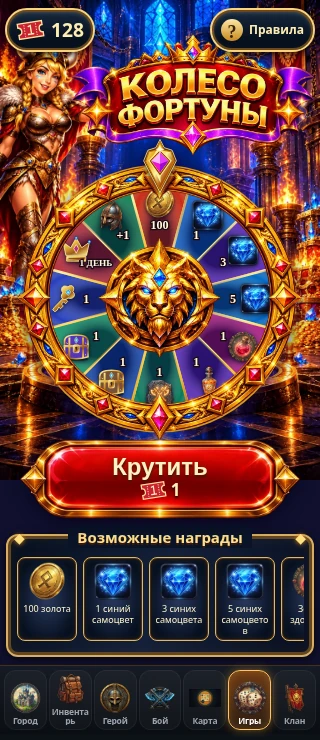
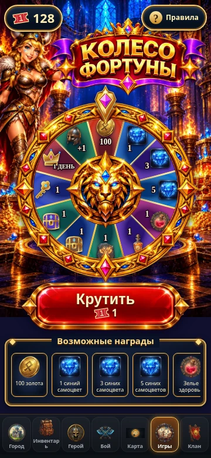
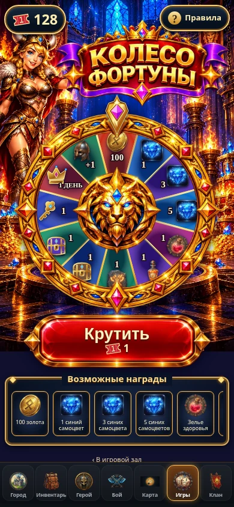
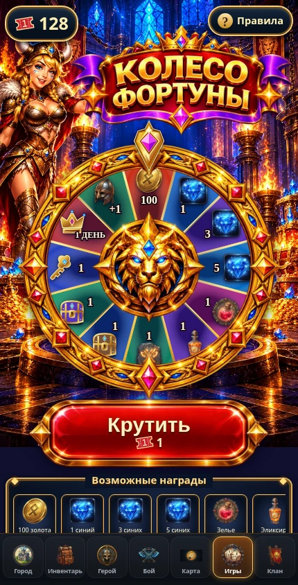

# Approved Wheel of Fortune — visual correction

Visual-only correction against published `main` (`7d1a528`). This replaces the
purple rectangular title, realistic hostess, plain wheel/empty fleur-de-lis
center and vertical reward grid with layers created from the owner's approved
reference. It is a working animated game, not a screenshot with invisible buttons.

- New ruby-and-gold curved title plaque, crown, purple ribbons and gemstones;
  Russian and English artwork, with accessible DOM headings.
- Reference-directed smiling blonde Viking hostess and sapphire treasure chamber.
- Transparent, engraved gold wheel rim with inset jewels and a sculpted golden
  lion medallion. The live twelve SVG sectors, resource icons, quantities, rim
  and lion rotate together. The separate gold-and-amethyst pointer stays above
  the wheel. No obsolete reference prize quantities are baked into these assets.
- Red enamel/gold Spin button with live disabled/loading states and standard
  one-ticket cost. Ticket balance is upper left, Rules upper right; Back is a
  subtle control beneath the gallery.
- A framed horizontal reward gallery replaces the tall grid. Its twelve entries
  retain the actual approved names/quantities and can be swiped or keyboard-scrolled.
- Wheel width adapts to narrow and short WebViews. Main content remains in the
  existing flex scroll pane, with bottom/safe-area spacing. Rules begin at their
  heading instead of auto-scrolling to the final OK button.
- Only the Wheel receives the existing lobby's gold Games-tab treatment and
  inactive Battle treatment. The lobby/card artwork is unchanged. Battle's
  existing blue appearance remains unchanged outside the Wheel.

## Preserved behavior and economy

No files under `src/game/` or `supabase/` were changed. There are no database
migrations, backend deployments, probability/quantity changes, ticket-wallet
changes or changes to payouts, receipts, recovery, VIP, hero levels or chest loot.
The published `HALL_TICKET_MAX` validation is retained; tests use the existing
128-ticket balance and the existing client suite also covers 1000 tickets.

The spin/recovery/acknowledgement handlers and `fortuneRotation` mapping are
unchanged. The illustrated title/frame/button are separate assets; the SVG still
has twelve individually mapped live sectors. Existing Game Hall cards, Monopoly,
admin, authentication and saved progress are untouched.

## Actual Chromium screenshots

These show the production Wheel component, production CSS, and the navigation
markup extracted from `src/App.tsx`, inside its actual flex/scroll/nav structure.
The backend is an explicitly isolated test transport: no production accounts,
keys, balances or tickets were accessed. Screenshots are desktop Chromium mobile
viewports, not physical Telegram-device screenshots.

| 320 × 740 | 360 × 780 |
|---|---|
|  |  |

| 390 × 844 | 430 × 844 |
|---|---|
|  |  |

Short WebViews also pass: [320 × 640](wheel-320x640.webp),
[430 × 644](wheel-430x644.webp). Content below the initial viewport can scroll
above the navigation, including the gallery and Back control.

[Rules dialog](rules-390.webp) · [Confirmed reward dialog](reward-390.webp)

## Verification

Passed:

- `npm run typecheck`
- `npm run build`
- `npm run test:wheel`
- `npm run test:hall`
- `npm run test:mobile-home`
- `npm run test:feature-separation`
- `node scripts/check-monopoly-visuals.mjs`
- `npm run test:wheel:browser`
- `git diff --check`

The browser suite now renders the real persistent navigation, uses an intercepted
HTTP test origin instead of file URLs, and wraps components in the production
language provider. It verifies all four required widths plus two short viewports,
no horizontal overflow, complete initial Spin-button visibility and hit testing,
128 tickets, all twelve exact sector-to-outcome mappings and landing angles,
centered pointer, ornate/lion asset layer, compact title, Games-only active nav,
restoration of Battle's original styling outside the Wheel, horizontal gallery
scrolling, reachable Back, Rules/results, recovery after remount, golden opening,
reduced motion, animation skip, a complete natural spin and English title/rules.

Measured layout and all twelve landing angles are in
[verification.json](verification.json). Tests of payouts and resource economy
remain the existing unchanged backend/client regression suites.

The optional targeted ESLint check reports zero errors and the pre-existing
`recover` effect-dependency warning in `WheelOfFortune.tsx`; the effect's spin and
recovery logic was deliberately preserved.

## Remaining visual limits

The artwork is newly rendered from the approved reference, so engraving,
individual jewels and character details are not pixel-identical to it. It uses
optimized WebP/transparent SVG layers and the game's canonical resource icons.
Short WebViews scroll to reach the entire gallery/Back control. Physical
Android/iPhone Telegram testing remains unperformed; no device verification is
claimed. No merge or deployment was performed.
