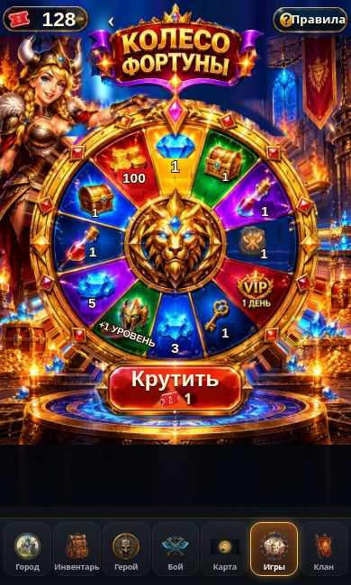
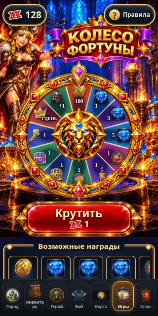
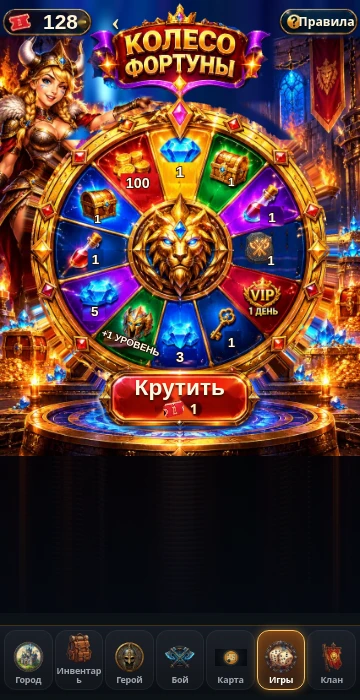
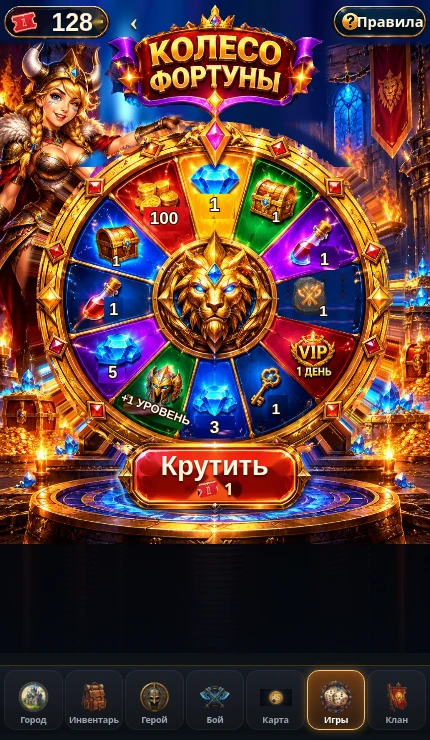

# Original Wheel artwork restoration — PR #58

This visual correction uses the **owner’s actual attached image**, not generated
replacement art. The source is [fortune-reference.jpg](../../scripts/artwork/fortune-reference.jpg)
(853 × 1280), SHA-256
`6407eea43395cdb84603b882d3b4d03cab0f361072a9925b2e02dbd65af7926b`.

## Original artwork layers

`scripts/extract-fortune-art.py` produces optimized transparent WebP layers from
the source using manually traced masks and source-texture retouching. No image
generation was used for this restoration. The rejected generated assets were deleted.

- Original smiling hostess and castle/torch/treasure scenery remain stationary.
- The original ornate title plaque is independently masked, including its actual
  gold lettering, crown, purple ribbons and gems.
- The original wheel rim, jewels, sector paintings and blue-eyed golden lion
  rotate together. The original pointer is a separate stationary layer.
- Original ticket, Rules and Spin frames are extracted. Their live balance,
  labels, cost and disabled/loading states are real accessible controls.
- The entire bottom possible-rewards panel is removed, without a replacement
  gallery/list/grid. Rules retain the twelve exact probabilities.

The old numerical labels and their shadows are removed with neighboring texture
from the same painted sectors. Live SVG text supplies approved quantities.
The original VIP “1 ДЕНЬ” remains because it is already correct. The obsolete
scroll is removed completely and replaced with the existing canonical battle
stone image; all other prize illustrations remain original source art.

The presentation order follows the original painting, clockwise from the top:
gem ×1, rare chest, strength elixir, battle stone, VIP, key, gems ×3, +1 level,
gems ×5, health potion, common chest, gold ×100. A presentation-only mapping
converts server outcome indices to those painted slots. Probabilities and
server outcome order are unchanged.

The flattened image occludes small rim areas beneath the pointer, fingers and
button. These are repaired using engraved rim pixels from the same source.
The old static wheel is removed from the background, with concealed castle
areas reconstructed using original source textures. There is no second static
wheel underneath the rotating wheel. The original platform remains below Spin;
taller viewports extend the subdued source stone floor to the existing navigation.

## Provenance and visual limits

`python scripts/check-fortune-original-art.py` verifies 41,545 unchanged central
lion pixels, exact opaque title/pointer pixels, and the original hostess face.
It also checks retouched obsolete labels/scroll, cleared background and absence
of generated-art/gallery references. The manifest is
[original-art.json](../../public/fortune/original-art.json).

The lion, hostess, title and decorations are recognizable original source pixels.
Repaired occlusions, background reconstruction and replacement numerical text
cannot be pixel-identical to the flattened reference. The original supplied file
is 853px wide; it is not enlarged into higher-resolution invented artwork.
The original Russian title/VIP lettering stays embedded in the artwork in English
mode too; accessible headings, controls, live level text and Rules are translated.

## Mobile and interaction verification

Actual production React components, CSS and App navigation markup are rendered
in Chromium with an isolated intercepted transport. No live player tickets,
balances, credentials or saves are used. These are browser viewport screenshots,
**not physical Android/iPhone Telegram tests**.

| 320 × 640 | 360 × 700 |
|---|---|
|  |  |

| 390 × 650 | 430 × 740 |
|---|---|
|  |  |

Additional screenshots: [320 × 568](wheel-320x568.webp),
[430 × 644](wheel-430x644.webp), [390 × 844](wheel-390x844.webp),
[430 × 844](wheel-430x844.webp), [simulated safe area](wheel-safe-area-390.webp),
[rotating original wheel](wheel-spinning-390.webp),
[Rules](rules-390.webp), [confirmed reward](reward-390.webp).

Browser checks cover eight narrow/short/tall viewports, a simulated 20px top /
34px bottom safe area, a fully accessible Spin button above navigation, no
horizontal overflow, all twelve quantity/sector mappings and exact stopping
angles, 128 existing tickets, Games-only gold highlight, restored Battle styling
outside the Wheel, absent bottom rewards panel, Rules/results, double-click
protection, remount recovery, golden chest opening, reduced motion, skip,
a complete normal spin and English controls/Rules.
Measurements are in [verification.json](verification.json).

## Checks

- `npm run typecheck`
- `npm run build`
- `npm run test:wheel`
- `npm run test:hall`
- `npm run test:mobile-home`
- `npm run test:feature-separation`
- `npm run test:wheel:browser`
- `node scripts/check-monopoly-visuals.mjs`
- `python scripts/check-fortune-original-art.py`
- `git diff --check`

## Preserved systems

No changes to `src/game/`, Supabase migrations/RPCs, admin, Monopoly or Game Hall
card artwork. No new migrations need applying. Existing one-ticket spending,
all twelve approved probabilities/quantities, payouts, save revisions, VIP,
levels, inventory, chest/key mechanics, idempotency and recovery remain intact.
Only the rendered sector index is remapped to match the original painting.
The existing ticket validation supports 128 and 1000 tickets; no old 20-ticket
limit was introduced. Existing focus/scroll fixes keep Rules usable.

PR #58 remains for owner review. No merge or deployment is performed.
