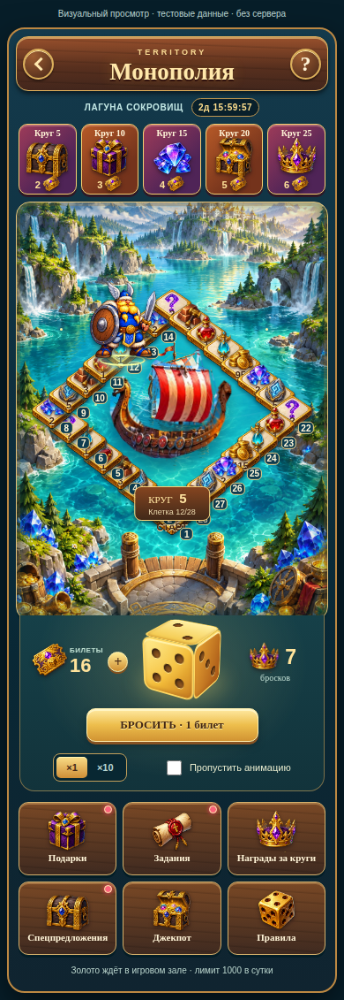
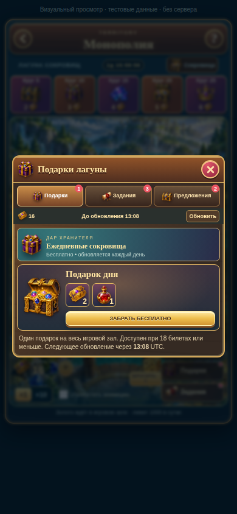
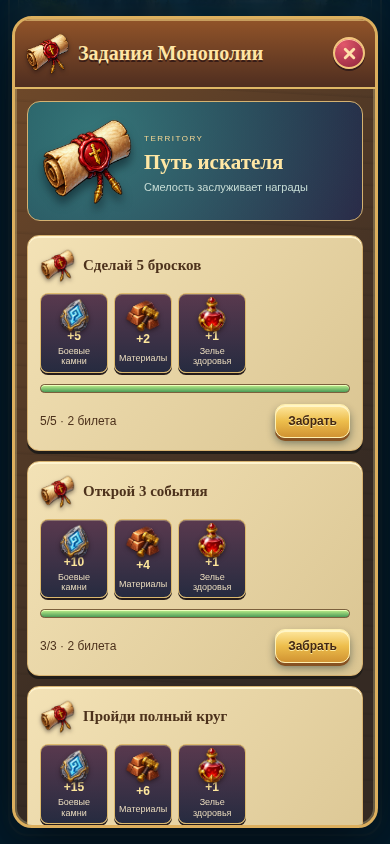
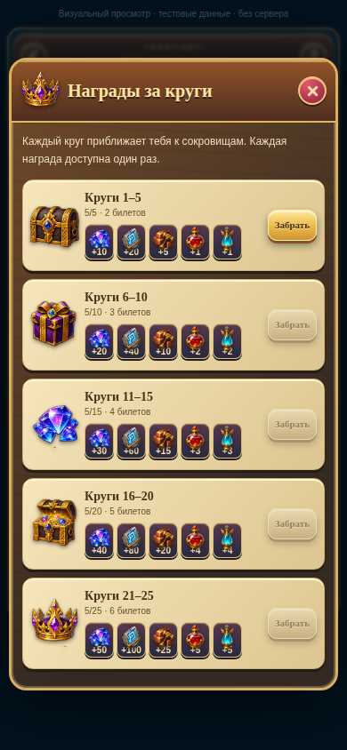

# Графика Монополии — локальный визуальный просмотр

Продолжается существующий PR #36. Игровые API, SQL, данные и экономика в этом обновлении не меняются. Из существующих исходников меняются только компонент и CSS Монополии; добавлены её изображения, графические компоненты и отдельный автономный просмотр.

## Что подключено

- `public/monopoly/lagoon.png`: созданная оригинальная фэнтезийная лагуна с бирюзовой водой, островами, замком, горами, водопадами, деревьями, кристаллами и сокровищами.
- Большой прозрачный корабль TERRITORY в центре, с плавным покачиванием.
- `art-atlas.png`: 16 оригинальных прозрачных игровых изображений. Монеты, алмазы, рунный камень, кузнечные материалы, зелья, эликсиры, закрытый/открытый сундуки, кубик, свиток, подарок, корона, три объёмные плитки и билет.
- Атлас разделяется точными CSS-координатами 4×4; фон прозрачный (проверено наличие alpha 0–255). Изображения не показываются белыми прямоугольниками, весь атлас целиком не выводится.
- `hero-frames.png`: четыре кадра героя TERRITORY, отдельные idle и walk последовательности. Координаты движения берутся из прежних boardPoint/серверных позиций.
- Ровно 28 объёмных клеток, явно пронумерованных 1–28. `data-cell-index` остаётся 0–27 и совпадает с механикой.
- Золотой кубик построен объёмно из шести CSS-граней с настоящими точками, вращается при броске. Полученное число приходит из прежней логики.
- Подарки, задания, круговые награды, предложения и правила оформлены деревом, золотом и кристаллами. Получение приза показывает открывающийся сундук и лучи.
- «Джекпот» существует только как честное окно «недоступен»: серверной механики нет, билеты не списываются и розыгрыш не симулируется.

Окна ограничены высотой 100dvh и прокручиваются, учтены safe-area и reduced-motion. При маленькой ширине сокращаются отступы. Это адаптация с браузерными проверками Chromium на ширинах 320/375/390 px. Проверка на физических устройствах в Telegram всё ещё требуется.

## Простой способ посмотреть

Подготовлен автономный HTML `monopoly-visual-review.html` (вне исходников, около 10 MB). Скачайте файл и откройте его в Chrome/Safari. Все иллюстрации и код внутри, установка SQL, вход в Telegram, ключи и сервер не нужны. На компьютере можно включить мобильный режим браузера (390×844 или 375×812); на телефоне открыть скачанный HTML браузером. Если файловый просмотрщик телефона показывает текст вместо страницы, открыть файл через Chrome/Safari либо попросить помощника открыть его в локальном браузере компьютера.

Сверху явно написано «Визуальный просмотр · тестовые данные · без сервера». Это тот же компонент Монополии с отдельными фикстурами ответов, а не концепт-картинка и не работающий баланс. Нажмите «Подарки», «Задания», «Награды за круги», «Спецпредложения», «Правила». Нажатие кубика показывает анимацию и окно приза на тестовых данных.

Повторно собрать автономный файл из ветки:

```bash
npm ci
node scripts/build-monopoly-visual-preview.mjs /tmp/monopoly-visual-review.html
```

Этот отдельный preview не импортирован в App/рабочий маршрут и ничего не публикует. Никаких production API в просмотре нет; window.fetch перехвачен фикстурами, адрес клиента — offline-visual.invalid.

## Реальные мобильные скриншоты

Локальный Chromium заблокирован sandbox: `SIGTRAP`, `setsockopt: Operation not permitted`. Для проверки использован Chromium в GitHub Actions, без развёртывания сайта и без доступа к Supabase. Визуальный просмотр содержит те же production-компоненты и изображения, а ответы API — явно помеченные фикстуры.

[Главное поле](screenshots/01-board-390.png) · [Подарки](screenshots/02-gifts-390.png) · [Задания](screenshots/03-quests-390.png) · [Награды за круги](screenshots/04-laps-390.png) · [Предложения](screenshots/05-offers-390.png) · [Получение приза](screenshots/06-reward-390.png).

Дополнительно: [375 px](screenshots/07-board-375.png), [320 px](screenshots/07-board-320.png), [машинный отчёт](screenshots/verification.json). Это снимки собранного HTML-интерфейса настоящим браузером, а не сгенерированные концепции. Снимки сохраняются ботом только в текущую ветку PR #36; workflow не может публиковать сайт или менять main.

При просмотре первого набора найдены и исправлены два дефекта: плашка круга мешала нижним номерам; окно заданий требовало лишней прокрутки. Номера вынесены поверх персонажа, плашка перенесена ниже маршрута, карточки уплотнены. Переключение ×1/×10 стало двумя явными кнопками без изменения стоимости/наград.

Галерея для владельца:









Физические Android/iPhone, Telegram WebView и реальная авторизация остаются непроверенными. Браузерный визуальный просмотр с фикстурами не подтверждает работу рабочей БД и не означает утверждение владельцем. PR остаётся draft, merge/публикации/SQL-установки нет.
